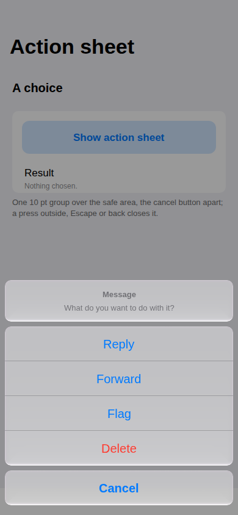
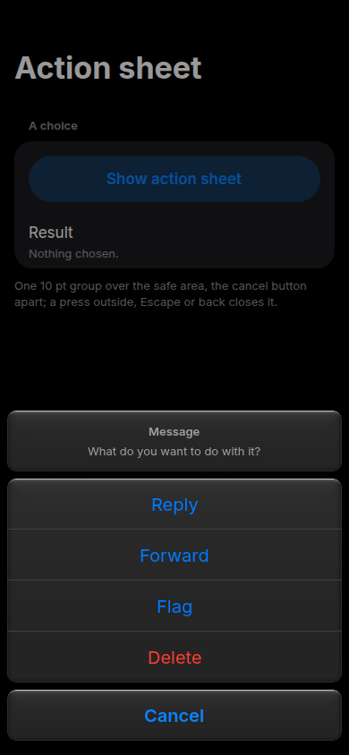

[简体中文](action-sheet.zh-CN.md)

# Action sheet

A choice between a few actions, in 10 pt groups over the safe area: the actions
in one group, the cancel button in another, 8 pt apart.

| | |
| --- | --- |
| Light |  |
| Dark |  |

| TSX | Rust | Type | Default | |
| --- | --- | --- | --- | --- |
| `open` | `.open(..)` | `boolean` | — | Controlled; follow `onOpenChange` |
| `defaultOpen` | `.default_open(..)` | `boolean` | `false` | Open at first |
| `title` | `.title(..)` | `string` | none | 13 pt semibold, centered |
| `message` | `.message(..)` | `string` | none | 13 pt secondary label |
| `actions` | `.actions(..)` | `SheetAction[]` | `[]` | The actions |
| `cancel` | `.cancel(..)` | `string` | `"Cancel"` | `""` hides it |

`SheetAction`: `{ id, title, destructive?, disabled? }`.

Events: `onOpenChange(open)`, `onAction(id)`, `onCancel()`.

Notes

- Rows are at least 57 pt, 20 pt titles; a destructive action is red and its
  name says "destructive" to screen readers.
- The groups are the `regular` material (`tokens::materials`): its fill over a
  25 pt blur; without a blur (Linux) the fill alone keeps them readable.
- Secondary label text keeps Apple's contrast ([issue #3](https://github.com/markbang/nsh-cupertino/issues/3)); the material does not
  change it.
- A press on the backdrop, Escape, back and the cancel button report `onCancel`.

## Accessibility

- The sheet is a dialog; each action is a button with its title as its name.
  Disabled actions are announced as dimmed and report nothing.

## Motion

The groups fade and rise 60 pt on entrance; each press is a fill, with a light
haptic on touch screens.
