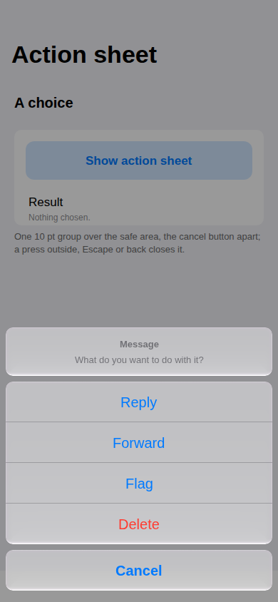
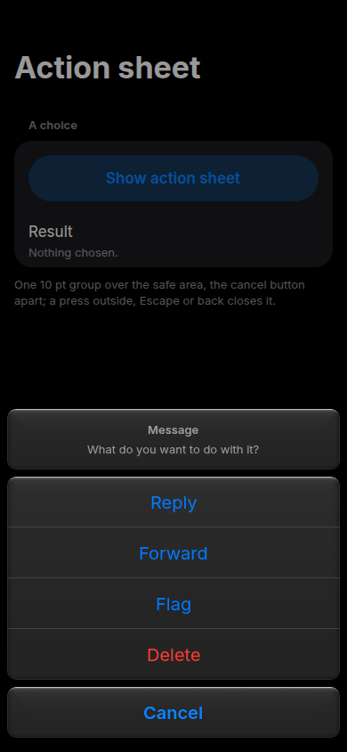

[English](action-sheet.md)

# 操作表 Action sheet

在安全区上方的两组 10 pt 圆角操作：动作一组，取消按钮单独一组，间距 8 pt。

| | |
| --- | --- |
| 浅色 |  |
| 深色 |  |

| TSX | Rust | 类型 | 默认 | |
| --- | --- | --- | --- | --- |
| `open` | `.open(..)` | `boolean` | — | 受控；跟随 `onOpenChange` |
| `defaultOpen` | `.default_open(..)` | `boolean` | `false` | 初始打开 |
| `title` | `.title(..)` | `string` | 无 | 13 pt 半粗，居中 |
| `message` | `.message(..)` | `string` | 无 | 13 pt 次要文字 |
| `actions` | `.actions(..)` | `SheetAction[]` | `[]` | 动作列表 |
| `cancel` | `.cancel(..)` | `string` | `"Cancel"` | 传 `""` 可隐藏 |

`SheetAction`：`{ id, title, destructive?, disabled? }`。

事件：`onOpenChange(open)`、`onAction(id)`、`onCancel()`。

说明

- 每行至少 57 pt，标题 20 pt；破坏性操作为红色，无障碍名称会带上 "destructive"。
- 组使用 `regular` 材质（`tokens::materials`）：填充叠加 25 pt 模糊；没有模糊的平台（Linux）只靠填充仍可读。
- 次要文字沿用 Apple 的对比度（[issue #3](https://github.com/markbang/nsh-cupertino/issues/3)），材质不会改变它。
- 点击遮罩、Escape、返回和取消按钮都会上报 `onCancel`。

## 无障碍

- 整组是 dialog，每个动作是按钮，名称就是标题；禁用项会被读作不可用且不响应。

## 动效

进场时整组淡入并上移 60 pt；按下为填充高亮，触屏有轻触感反馈。
