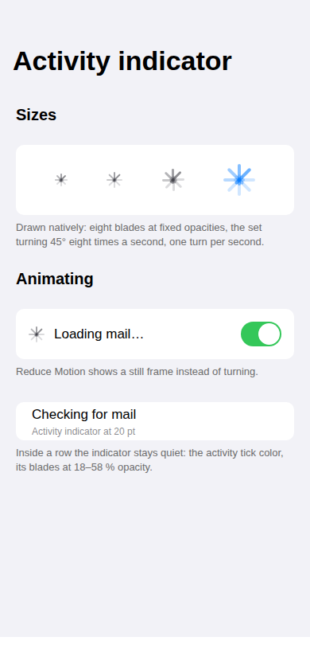
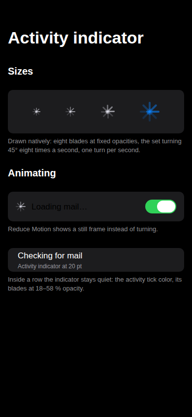

[简体中文](activity-indicator.zh-CN.md)

# Activity indicator

iOS's spinner: eight rounded blades around a circle, each at its own opacity, the
set turning one step (45°) every 1/8 s, one turn per second — `CupertinoActivityIndicator`'s
geometry and alpha table, drawn natively.

| | |
| --- | --- |
| Light |  |
| Dark |  |

| TSX | Rust | Type | Default | |
| --- | --- | --- | --- | --- |
| `size` | `.size(..)` | `number` | `20` | The box in points; the blades scale with it |
| `color` | `.color(..)` | token name | `activity-tick` | The blades' color (`#3C3C44` light, `#EBEBF5` dark) |
| `label` | `.label(..)` | `string` | none | What screen readers say: name the task, not the wait |
| `animating` | `.animating(..)` | `boolean` | `true` | `false` freezes a still frame |

Notes

- The blades' alphas are `CupertinoActivityIndicator`'s own table
  (`47, 47, 47, 47, 72, 97, 122, 147` of 255) and their shape is its
  `tickFundamentalShape`: 1/10 of the diameter wide, 2/3 of the radius long, a
  1/20 corner.
- The turn is one native keyframe animation on the whole set, stepped eight times
  a second: no frame reaches Rust or JS.
- With reduced motion (`reduceMotion()`) the blades show a still frame instead of
  turning, so nothing moves for users who asked for that.
- Name the task in `label` ("Checking mail"), not the fact that it loads, as the
  guidelines ask.

## Accessibility

- Role progress indicator, named by `label`.

## Motion

1000 ms per turn, in eight steps, forever. The still frame keeps the same
gradient of opacity, so the shape reads the same.
