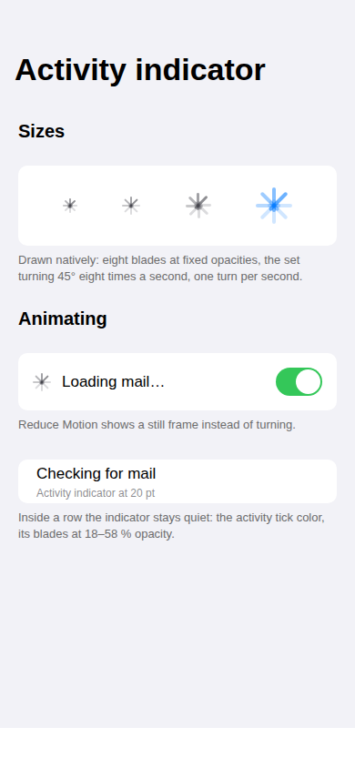
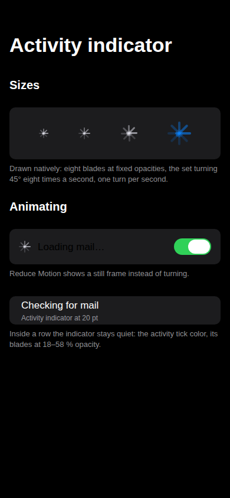

# 活动指示器

iOS 的加载指示器：圆周上八片圆角叶片依次淡出，每 800 ms 转一圈，原生绘制。

| | |
| --- | --- |
| 浅色 |  |
| 深色 |  |

| TSX | Rust | 类型 | 默认值 | |
| --- | --- | --- | --- | --- |
| `size` | `.size(..)` | `number` | `20` | 盒子的点数；叶片随之缩放 |
| `color` | `.color(..)` | token 名 | `tertiary-label` | 叶片颜色 |
| `label` | `.label(..)` | `string` | `"Loading"` | 读屏名称 |
| `animating` | `.animating(..)` | `boolean` | `true` | `false` 时静止在一帧 |

说明

- 每片叶子的透明度是 UI 线程上的关键帧动画，彼此错开一步：旋转的每一帧都不会进入 Rust 或 JS，
  代价是每片叶子一个 animated value。
- 开启"减少动态效果"（`reduceMotion()`）时叶片静止在一帧，不为这类用户提供运动。
- `tertiaryLabel` 是 iOS 在行内使用的颜色；需要醒目时传 `"system-blue"`。

## 无障碍

- 角色为 progress indicator，名称为 `label`。

## 动效

每圈 800 ms，线性，无限循环。静止帧保留同样的透明度梯度，所以形状可读性一致。
