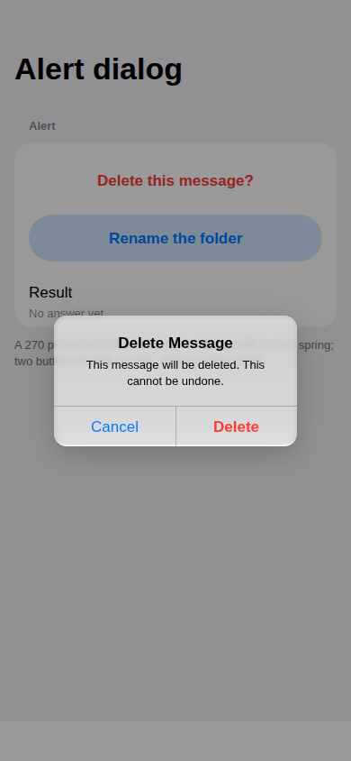
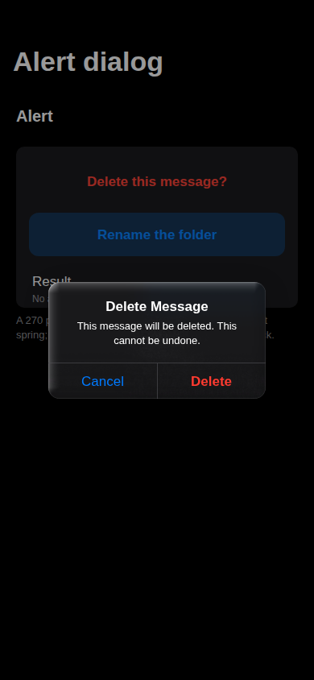

[简体中文](alert-dialog.zh-CN.md)

# Alert dialog

iOS's alert: a 270 pt card in the middle of a dimmed page, with a title, a
message, an optional text field and a row of buttons.

| | |
| --- | --- |
| Light |  |
| Dark |  |

| TSX | Rust | Type | Default | |
| --- | --- | --- | --- | --- |
| `open` | `.open(..)` | `boolean` | — | Controlled; follow `onOpenChange` |
| `defaultOpen` | `.default_open(..)` | `boolean` | `false` | Open at first |
| `title` | `.title(..)` | `string` | none | 17 pt semibold, centered |
| `message` | `.message(..)` | `string` | none | 15 pt, centered |
| `actions` | `.actions(..)` | `DialogAction[]` | `[]` | Two side by side, three or more stacked |
| `input` | `.input(..)` | `string` | none | Placeholder of the text field |
| `value` | `.value(..)` | `string` | `""` | The field's text at first |

`DialogAction`: `{ id, title, destructive?, preferred? }`; `preferred` is the
semibold default button.

Events: `onOpenChange(open)`, `onAction(id, text)`, `onCancel()`.

Notes

- The card's shadow is 0 8 pt offset, 32 pt blur, 3 pt spread, black at 20 %,
  fitted to the UIKit system alert in the iOS reference shot (`catalog-confirm`) on a light
  page; it does not show on a dark page, as in the reference. It is not cohub's `shadow-glass`:
  on iOS, cohub-mobile's alerts are UIKit's (`SystemDialogs.ios.tsx:2`, `:58`, `:75`).
- The card is the `thick` material: its fill over a 30 pt blur. Secondary text
  keeps Apple's contrast ([issue #3](https://github.com/markbang/nsh-cupertino/issues/3)).
- The text-entry variant is the standard iOS alert with one field; the field's
  text travels with the action, so the app needs no draft of its own.
- Hairlines between buttons are one device pixel (`separator_thickness`).
- A press outside, Escape, back and the cancel action all report `onCancel`.

## Accessibility

- Role alert dialog; the card takes the focus as it appears; each button is a
  button whose name is its title; the field is a labeled text field.
- The keyboard reaches the field and the buttons; Return presses the focused
  one.

## Motion

It appears with a short spring, scaling from 1.16 to 1 over 180 ms. Reduce
Motion appears it at once.
