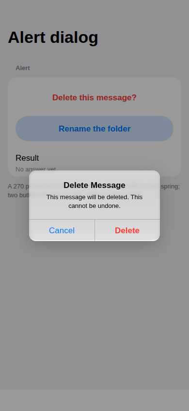
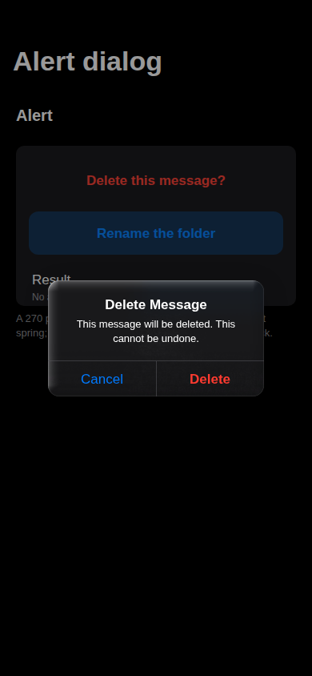

[English](alert-dialog.md)

# 警告框 Alert dialog

iOS 的警告框：暗色页面中央的 270 pt 卡片，包含标题、正文、可选输入框和一行按钮。

| | |
| --- | --- |
| 浅色 |  |
| 深色 |  |

| TSX | Rust | 类型 | 默认 | |
| --- | --- | --- | --- | --- |
| `open` | `.open(..)` | `boolean` | — | 受控；跟随 `onOpenChange` |
| `defaultOpen` | `.default_open(..)` | `boolean` | `false` | 初始打开 |
| `title` | `.title(..)` | `string` | 无 | 17 pt 半粗，居中 |
| `message` | `.message(..)` | `string` | 无 | 15 pt，居中 |
| `actions` | `.actions(..)` | `DialogAction[]` | `[]` | 两个并排，三个及以上竖排 |
| `input` | `.input(..)` | `string` | 无 | 输入框占位文字 |
| `value` | `.value(..)` | `string` | `""` | 输入框初始文字 |

`DialogAction`：`{ id, title, destructive?, preferred? }`；`preferred` 为半粗的默认按钮。

事件：`onOpenChange(open)`、`onAction(id, text)`、`onCancel()`。

说明

- 卡片阴影为向下 8 pt 偏移、32 pt 模糊、3 pt 扩散、20% 黑色，按 iOS 参考画面（`catalog-confirm`）中 UIKit 系统弹窗在浅色页面上的衰减拟合；深色页面上看不出阴影，与参考画面一致。它不是 cohub 的 `shadow-glass`：iOS 上 cohub-mobile 的弹窗是 UIKit 的（`SystemDialogs.ios.tsx:2`、`:58`、`:75`）。
- 卡片使用 `thick` 材质：填充叠加 30 pt 模糊。次要文字沿用 Apple 的对比度（[issue #3](https://github.com/markbang/nsh-cupertino/issues/3)）。
- 文本输入变体就是标准的单输入框警告框；输入内容随动作一起返回，应用不必自己保存草稿。
- 按钮之间的分隔线是一台设备像素（`separatorThickness`）。
- 点击外部、Escape、返回和取消动作都会上报 `onCancel`。

## 无障碍

- 角色为 alert dialog；出现时焦点进入卡片；每个按钮以标题命名；输入框有名称。

## 动效

180 ms 内从 1.16 缩放到 1 的短弹簧。"减弱动态效果"时直接出现。
