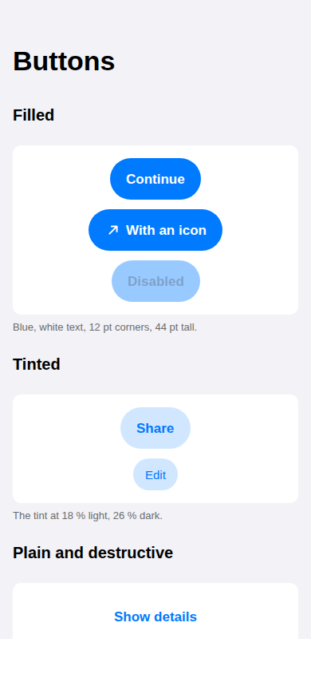
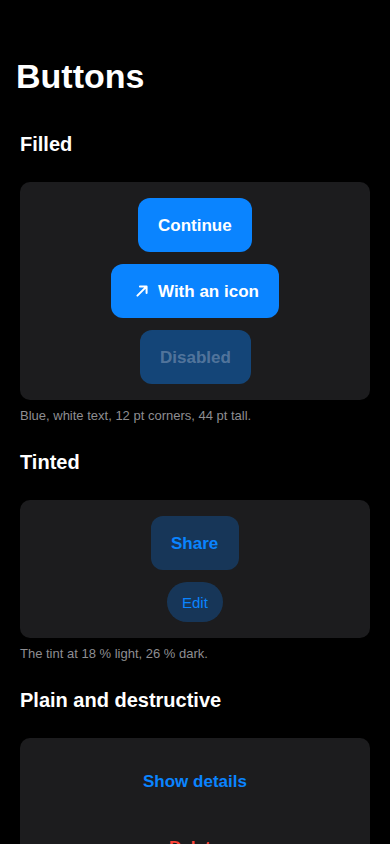

[简体中文](button.zh-CN.md)

# Button

iOS's four button looks, with the pressed state iOS draws: the whole button fades
to 40 % over 120 ms and back over 180 ms (`CupertinoButton`'s `kFadeOutDuration`
and `kFadeInDuration`).

| | |
| --- | --- |
| Light |  |
| Dark |  |

| TSX | Rust | Type | Default | |
| --- | --- | --- | --- | --- |
| `title` | `.title(..)` | `string` | none | The text; leave it out for an icon-only button |
| `variant` | `.variant(..)` | `"filled"` \| `"tinted"` \| `"plain"` \| `"destructive"` | `filled` | The look |
| `size` | `.size(..)` | `"large"` \| `"medium"` \| `"small"` | `large` | Padding and text size |
| `icon` | `.icon(..)` | icon name | none | An icon before the title |
| `disabled` | `.disabled(..)` | `boolean` | `false` | Dimmed, reports nothing |
| `label` | `.label(..)` | `string` | none | What screen readers say, for an icon-only button |

Events: `onPress`.

Looks

- **filled**: `systemBlue` background (the tint), white text.
- **secondary**: `systemGray5` background, label text.
- **danger**: `systemRed` background, white text.
- **tinted**: the tint at 18 % in light and 26 % in dark, blue text.
- **plain**: blue text only.
- **destructive**: red text (iOS's destructive style), same shape as plain.
- `loading`: Cohub Mobile's small loader, the mascot's cheek turning in place (900 ms), in place of the icon; the whole button at 55 % and not pressable. With reduced motion it is still.

Sizes

| Size | Height | Text | Padding | Corners | Target |
| --- | --- | --- | --- | --- | --- |
| large | 52 pt | 17 semibold | 20 × 8 | capsule (26 pt) | 44 pt |
| medium | 32 pt | 15 semibold | 15 × 10 | pill (40 pt) | 44 pt |
| small | 28 pt | 15 semibold | 12 × 6 | pill (40 pt) | 44 pt |

Notes

- The large button is 52 pt, the height of Cohub Mobile's primary button; the
  medium and small ones keep `CupertinoButton`'s heights. A medium or small button
  grows its hit area to 44 pt, not its look, as the guidelines ask.
- A disabled button reports no presses and is announced as dimmed; its text
  takes the tertiary label color and a filled one keeps its tint at 40 %.
- An icon is drawn at 1.2 × the text size, as `CupertinoButton` sizes it.

## Accessibility

- Role button, named by `label`, else its title.
- Keyboard focus draws a ring (`focus-visible`); Space and Return press.

## Motion

`active:` fades the button to 40 % over 150 ms and back; there is no scale, as on
iOS.
