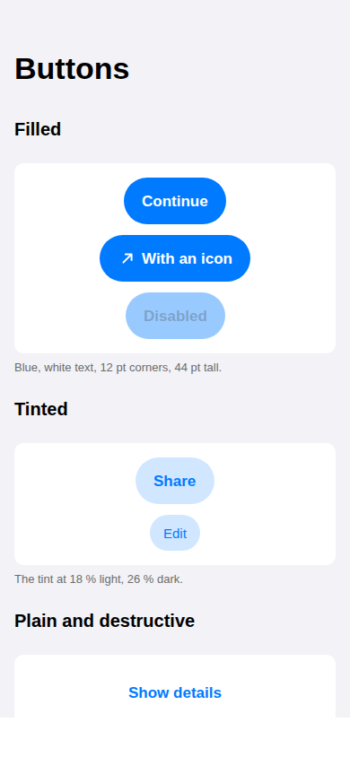
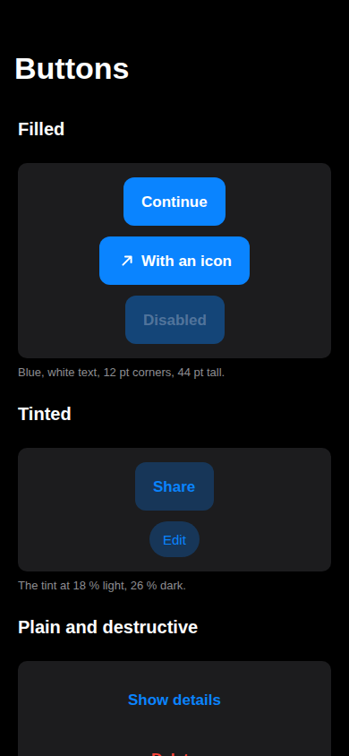

[English](button.md)

# 按钮

iOS 的四种按钮外观，以及 iOS 的按压状态：整颗按钮在 120 ms 内淡到 40 %，再在 180 ms 内恢复
（`CupertinoButton` 的 `kFadeOutDuration` 与 `kFadeInDuration`）。

| | |
| --- | --- |
| 浅色 |  |
| 深色 |  |

| TSX | Rust | 类型 | 默认值 | |
| --- | --- | --- | --- | --- |
| `title` | `.title(..)` | `string` | 无 | 文案；纯图标按钮可不传 |
| `variant` | `.variant(..)` | `"filled"` \| `"tinted"` \| `"plain"` \| `"destructive"` | `filled` | 外观 |
| `size` | `.size(..)` | `"large"` \| `"medium"` \| `"small"` | `large` | 内边距与字号 |
| `icon` | `.icon(..)` | 图标名 | 无 | 标题前的图标 |
| `disabled` | `.disabled(..)` | `boolean` | `false` | 变灰，不报告按压 |
| `label` | `.label(..)` | `string` | 无 | 读屏名称，用于纯图标按钮 |

事件：`onPress`。

外观

- **filled**：`systemBlue` 背景（即着色）、白色文字。
- **secondary**：`systemGray5` 背景、label 文字。
- **danger**：`systemRed` 背景、白色文字。
- **tinted**：浅色下 18 %、深色下 26 % 的着色，蓝色文字。
- **plain**：只有蓝色文字。
- **destructive**：红色文字（iOS 的危险操作样式），形状同 plain。

尺寸

| 尺寸 | 高度 | 文字 | 内边距 | 圆角 | 目标 |
| --- | --- | --- | --- | --- | --- |
| large | 52 pt | 17 半粗 | 20 × 8 | 胶囊（26 pt） | 44 pt |
| medium | 32 pt | 15 半粗 | 15 × 10 | 胶囊（40 pt） | 44 pt |
| small | 28 pt | 15 半粗 | 12 × 6 | 胶囊（40 pt） | 44 pt |

说明

- large 按钮高 52 pt，与 Cohub Mobile 的主按钮一致；medium 与 small 保持 `CupertinoButton` 的高度，
  只扩大命中区域到 44 pt，不放大外观，符合 Human Interface Guidelines。
- 禁用按钮不报告按压，读屏会读出"变灰"；文字使用 tertiary label 色，实心按钮的着色降到 40 %。
- 图标按文字大小的 1.2 倍绘制，与 `CupertinoButton` 一致。

## 无障碍

- 角色为按钮，名称为 `label`，否则为标题。
- 键盘焦点显示焦点环（`focus-visible`）；空格与回车可以按下。

## 动效

`active:` 在 150 ms 内淡到 40 % 再回来；不缩放，与 iOS 一致。
