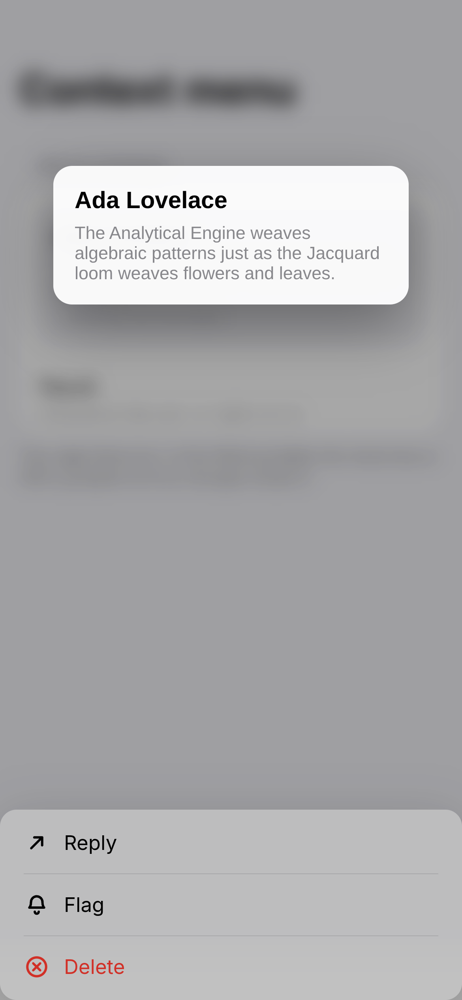
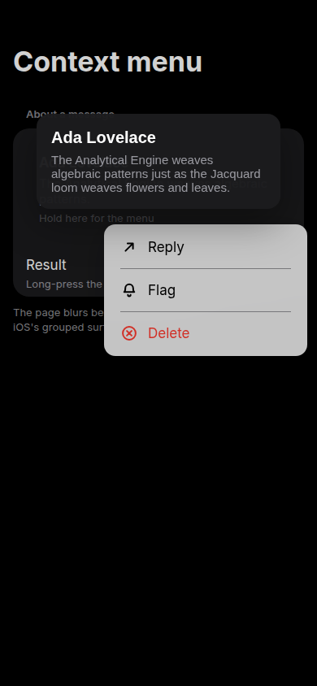

[简体中文](context-menu.zh-CN.md)

# Context menu

A menu about the content it wraps: a held finger on touch screens, the secondary
button on desktops, Shift+F10 or the Menu key when the trigger has the focus.

| | |
| --- | --- |
| Light |  |
| Dark |  |

| TSX | Rust | Type | Default | |
| --- | --- | --- | --- | --- |
| `trigger` | `.trigger(..)` | JSX | — | What the menu is about |
| `preview` | `.preview(..)` | JSX | none | The lifted card, shown while open |
| `actions` | `.actions(..)` | `ContextAction[]` | `[]` | The items |
| `disabled` | `.disabled(..)` | `boolean` | `false` | No menu |
| `open` | `.open(..)` | `boolean` | — | Controlled |

`ContextAction`: `{ id, title, icon?, destructive?, disabled? }`.

Events: `onOpenChange(open)`, `onAction(id)`.

Notes

- The preview and the menu are drawn in the library's top layer: a menu opened
  from a row inside a scroll view paints above the page, and follows the row.
- Behavior is `nsh/base`'s `ContextMenu`: the menu opens at the pointer on the
  desktops and as a sheet on phones, with the keyboard's menu keys and screen
  readers' show-menu action working.
- The preview is a separate card lifted over a dimmed page; it follows the
  trigger's content but its own copy is drawn (a `<ContextMenu>` cannot copy
  a subtree, so pass the preview explicitly).
- The menu's shadow is 0 4 pt offset, 40 pt blur, black at 13 %, fitted to the
  iOS reference's falloff on a light page; the preview keeps its own, deeper shadow.
- The menu and the preview are the `thick` material: its fill over a 30 pt blur.
- Items are 44 pt, 17 pt, with a leading icon and hairline separators.

## Accessibility

- The trigger keeps its own name and role; the menu is a menu, its items
  menuitems, and Escape or a press outside closes it.
- A screen reader's "show menu" action opens it on macOS and Windows.

## Motion

The preview rises with a zoom-in motion; the menu uses the platform's popup
motion. Reduce Motion shows the preview without the scale.
