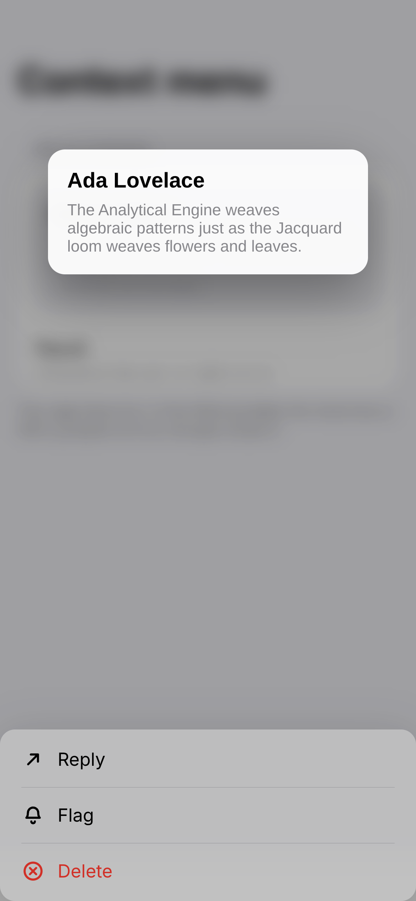
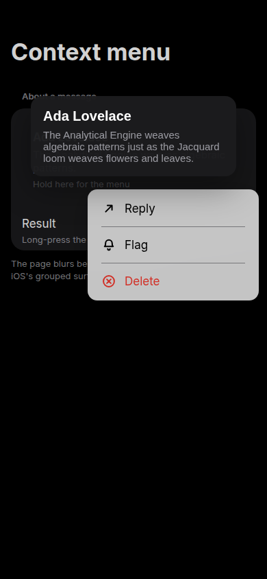

[English](context-menu.md)

# 上下文菜单 Context menu

围绕某块内容的菜单：触屏长按、桌面右键，或在触发器聚焦时按 Shift+F10 / 菜单键。

| | |
| --- | --- |
| 浅色 |  |
| 深色 |  |

| TSX | Rust | 类型 | 默认 | |
| --- | --- | --- | --- | --- |
| `trigger` | `.trigger(..)` | JSX | — | 菜单所属的内容 |
| `preview` | `.preview(..)` | JSX | 无 | 打开时抬起的预览卡片 |
| `actions` | `.actions(..)` | `ContextAction[]` | `[]` | 菜单项 |
| `disabled` | `.disabled(..)` | `boolean` | `false` | 禁用菜单 |
| `open` | `.open(..)` | `boolean` | — | 受控 |

`ContextAction`：`{ id, title, icon?, destructive?, disabled? }`。

事件：`onOpenChange(open)`、`onAction(id)`。

说明

- 行为来自 `nsh/base` 的 `ContextMenu`：桌面在指针处弹出，手机以底部面板呈现，并支持键盘菜单键与读屏的"显示菜单"。
- 预览是单独抬起的卡片，页面会变暗；由于组件无法复制子树，预览内容需要单独传入。
- 菜单与预览使用 `thick` 材质：填充叠加 30 pt 模糊。
- 每个菜单项 44 pt、17 pt 文字，带前置图标和细分隔线。

## 无障碍

- 触发器保留自己的名称与角色；菜单是 menu，条目是 menuitem，Escape 或点击外部关闭。
- macOS 与 Windows 上读屏的"显示菜单"动作可以打开它。

## 动效

预览以缩放淡入升起；菜单使用平台的弹出动效。"减弱动态效果"时预览不做缩放。
