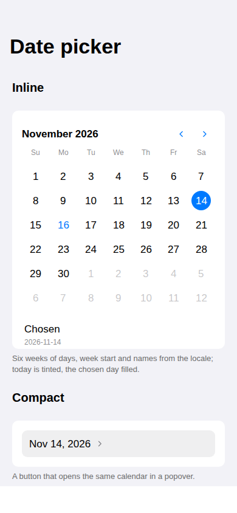
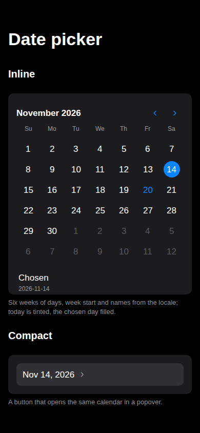

[简体中文](date-picker.zh-CN.md)

# Date picker

A calendar of the month around the chosen day, in the user's language and week
start, and a wheel of month, day and year. A compact variant is a button that
opens the calendar in a popover.

| | |
| --- | --- |
| Light |  |
| Dark |  |

| TSX | Rust | Type | Default | |
| --- | --- | --- | --- | --- |
| `value` | `.value(..)` | `YYYY-MM-DD` | today | Controlled |
| `defaultValue` | `.default_value(..)` | `YYYY-MM-DD` | today | At first |
| `variant` | `.variant(..)` | `"inline" \| "compact" \| "wheel"` | `"inline"` | The look |
| `label` | `.label(..)` | `string` | `"Date"` | What screen readers call it |

Events: `onChange(value)` with the picked day as `YYYY-MM-DD`.

Notes

- The calendar draws six weeks from the locale's first day of the week; days of
  the neighbouring months are dimmed and still pickable. Today's number is
  tinted, the chosen day is a filled blue circle.
- The wheel keeps the day within the month it lands in (31 March → February
  gives the 28th or 29th).
- `compact` opens the same calendar in a popover anchored to its button.
- Month and weekday names follow the app's language: English, or Chinese when
  the locale's language is `zh`.

## Accessibility

- The calendar is a group; each day is a button named "November 14, 2026", the
  chosen one selected. Previous and Next are named buttons.
- The wheel's columns are adjustables with names.

## Motion

The month arrows swap the grid at once (the popover and the wheel animate as the
platform does).
