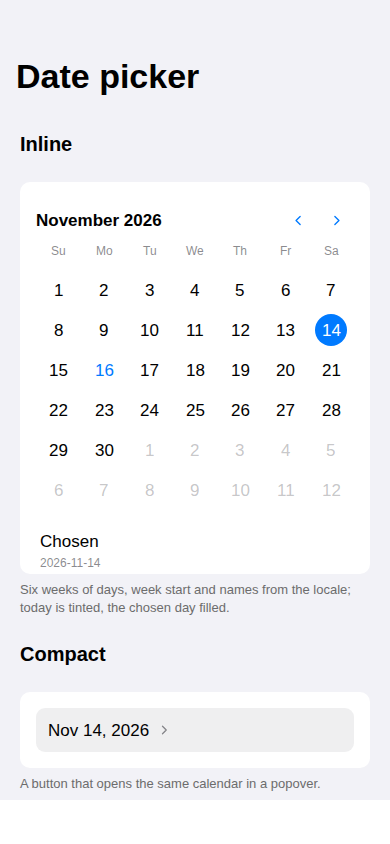
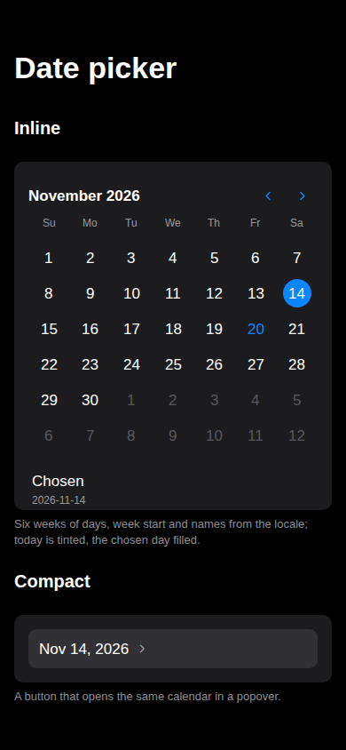

[English](date-picker.md)

# 日期选择 Date picker

所选日期所在月份的日历，使用用户的语言和周起始日；另有月、日、年三列滚轮。紧凑变体是一个按钮，在浮层中打开日历。

| | |
| --- | --- |
| 浅色 |  |
| 深色 |  |

| TSX | Rust | 类型 | 默认 | |
| --- | --- | --- | --- | --- |
| `value` | `.value(..)` | `YYYY-MM-DD` | 今天 | 受控 |
| `defaultValue` | `.default_value(..)` | `YYYY-MM-DD` | 今天 | 初始值 |
| `variant` | `.variant(..)` | `"inline" \| "compact" \| "wheel"` | `"inline"` | 外观 |
| `label` | `.label(..)` | `string` | `"Date"` | 无障碍名称 |

事件：`onChange(value)`，值为 `YYYY-MM-DD`。

说明

- 日历显示六周，从区域设置的一周首日开始；相邻月份的日期变淡且仍可选择。今天数字使用 tint 色，选中日为实心蓝圆。
- 滚轮会保证日期落在目标月份内（3 月 31 日切到 2 月时为 28 或 29 日）。
- `compact` 在按钮锚定的浮层中打开同一个日历。
- 月份和星期名称跟随应用语言：英文，或区域语言为 `zh` 时使用中文。

## 无障碍

- 日历是 group；每天是按钮，名称为"2026年11月14日"，选中日带 selected 状态；上一月/下一月是有名称的按钮。
- 滚轮各列是带名称的 adjustable。

## 动效

月份箭头直接换网格；浮层与滚轮按平台动效运行。
