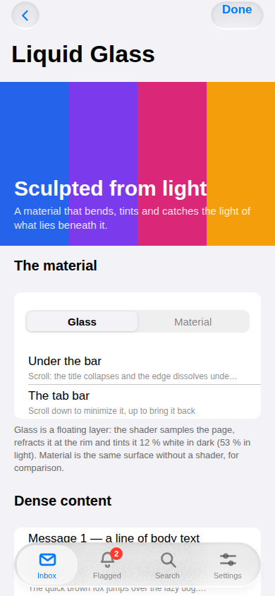
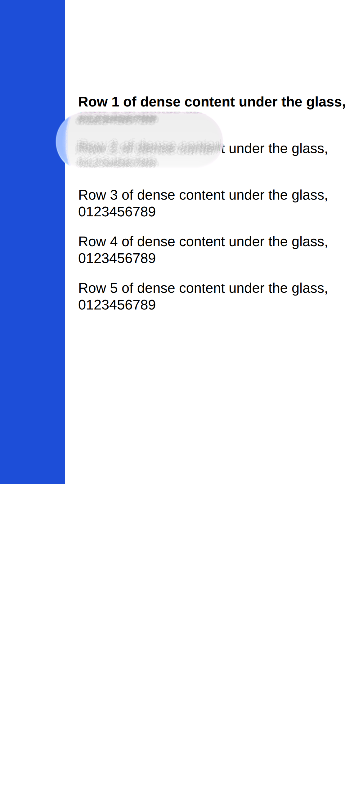

[简体中文](glass.zh-CN.md)

# Glass (Liquid Glass)

Apple's iOS 26 material: a sheet of glass over what is behind it. The surface
reads the backdrop through a GPU shader, bends it through a rounded-rect height
field (the rim refracts and magnifies what lies just outside it, the middle
stays flat), blurs it, tints it by variant and adds a specular rim whose lit
side follows the light. Content drawn over it stays crisp: the platform draws
the children, the shader draws the material under them.

| | |
| --- | --- |
| Light, over content that scrolls under it |  |
| Dark |  |
| No glass / the material without a GPU / the shader |  |

## `Glass`

| TSX | Rust | Type | Default | |
| --- | --- | --- | --- | --- |
| `shape` | `.shape(..)` | `"rounded" \| "capsule" \| "circle"` | `"rounded"` | Its silhouette |
| `radius` | `.radius(..)` | `number` | `0` | Corners of `"rounded"`, in points |
| `variant` | `.variant(..)` | `"regular" \| "clear" \| "thick" \| "interactive" \| "tinted"` | `"regular"` | Its look |
| `tint` | `.tint(..)` | `string` | `system-blue` | The token `"tinted"` uses |
| `light` | `.light(..)` | `number` | `225` | Where the light comes from, degrees |
| `quality` | `.quality(..)` | `"high" \| "balanced" \| "low"` | `"balanced"` | Blur samples: 17, 9 or 1 |
| `interactive` | `.interactive(..)` | `boolean` | `false` | It answers presses |
| `children` | | content | | What draws over it |

## `GlassButton`

| TSX | Rust | Type | Default | |
| --- | --- | --- | --- | --- |
| `title` | `.title(..)` | `string` | none | Its text |
| `icon` | `.icon(..)` | `string` | none | An icon before it |
| `label` | `.label(..)` | `string` | the title | Its name for screen readers |
| `disabled` | `.disabled(..)` | `boolean` | `false` | Dimmed, not pressable |

Events: `onPress()`.

## `GlassGroup`

| TSX | Rust | Type | Default | |
| --- | --- | --- | --- | --- |
| `shapes` | `.shapes(..)` | `GlassRect[]` | `[]` | One or two shapes |
| `mergedShapes` | `.merged_shapes(..)` | `GlassRect[]` | `shapes` | Where they spring to |
| `merged` | `.merged(..)` | `boolean` | `false` | Fuse them |
| `spacing` | `.spacing(..)` | `number` | `0` | How far apart they still fuse |
| `variant` | `.variant(..)` | `string` | `"regular"` | Its look |
| `children` | | content | | What draws over it |

`GlassRect`: `{ x, y, width, height, radius }` in points from the group's
top-left corner; a radius of `-1` is a capsule and `-2` a circle.

## What it costs

- A static surface draws **once**: the shader does not read `nsh.time`. It draws
  again when its size, its uniforms or the picture behind it changes — a scroll,
  an animated value, a variant change.
- `quality` trades blur samples for speed: `"high"` is 17 taps, `"balanced"` 9,
  `"low"` 1 (no blur of its own: the tint carries the material, for weak GPUs).
- An `interactive` surface animates on the UI thread: the press is one animated
  value, and the lens and the squash derive from it. Nothing
  runs in the app's code per frame.
- The lens and the blur read `maxSampleOffset` points beyond the box (the
  thickness of the lens plus the blur radius), so the platform keeps a picture
  that much larger than the surface. That is why the material is an *effect*, not
  a fill: a fill's pictures stop at its box on iOS and are squeezed into it on
  the web.

## Where it belongs

The floating layer only: navigation bars over scrolling content, tab bars,
sheets, action sheets, alerts, menus, floating controls. Never behind content,
and never behind text that cannot afford to lose contrast — a list row, a body
of a message. The HIG is explicit (*Materials*, *Liquid Glass*), and the
material's own legibility rules assume it.

## Platforms

| | |
| --- | --- |
| iOS, macOS, Windows, Linux, Android | wgpu (Metal, Vulkan, Direct3D 12, OpenGL): the shader draws the material, the platform draws the content over it. Android is verified by CI: an API 34 emulator with SwiftShader captures the pages and measures the lens ([`android-glass-*.png`](https://github.com/markbang/nsh-cupertino/tree/screenshots/main)). |
| Web | WebGL 2, through NSH's runtime. The material needs **the WebGL 2 uniform-block fix in `tools/patch-runtime.mjs`** until NSH binds both stages' blocks (see `docs/design-notes.md`); without it a web shader draws nothing. |
| No GPU (a browser without WebGL 2, a build without the shader compiler, a terminal) | The material's own fill and backdrop blur (`tokens::materials`), as the bars drew it before the shader: `tokens::glass` and `tokens::materials` agree on the look, and nothing else changes. |
| Reduce Motion | The press keeps its values and drops the springs; the entrance of a sheet still animates as it did. |
| Increased contrast | The glass fills come from `tokens::glass`, which follows `Theme`'s `contrast="high"`: near-opaque, as the HIG asks of glass it cannot guarantee contrast over. |

## Notes

- Variants: `regular` for bars, `thick` under text (sheets, alerts), `clear` for
  media only, `interactive` for a control, `tinted` for one action.
- The tint thickens on its own where the backdrop would fight the label — a
  bright picture under dark glass, a dark one under light glass — up to 96 %.
  That is the "adaptive" part of Apple's material, and it is why a bar keeps its
  text readable over a photo.
- The specular rim follows `light` (degrees, 225 = the upper left) and an
  app-driven `tilt` angle; NSH reports no device motion, so the tilt is the
  app's.
- `GlassGroup` reads Apple's `GlassEffectContainer` as one shader over two
  rects. It does not morph a shape's *content* between layouts, and it takes at
  most two shapes.

## Accessibility

- A `Glass` is decoration: it never takes a press unless it is `interactive`, and
  it carries no name.
- A `GlassButton` is a button with its label, its disabled state and its
  `onPress`; the press is also reported with a scale, so a screen reader user
  gets the same outcome.
- The material never moves text: `Reduce Motion` removes the squash and the
  springs, and the values are reached at once.

## The structure it belongs to

Liquid Glass is a design language, not only this surface. The pieces that carry
it in this crate:

- [`GlassTabBar`](tab-bar.md#glass-bar) — the floating capsule at the bottom of
  the screen (64 pt tall, radius 32, 20 pt insets), which minimises to a pill
  around the chosen tab as the page scrolls down and expands as it scrolls up.
- `NavPage` with a `material` — a floating navigation group: a 40 pt back
  circle, the title, and a capsule for the trailing action, over a scroll edge
  effect instead of a full-width band.
- [`ScrollEdge`](scroll-edge.md) — the graduated blur and fade at a page's edge
  that lets content dissolve under those controls.

The material itself is the same under all of them. `tools/glass-pixels.mjs`
measures it on the calibration page; `docs/design-notes.md` lists the numbers
and where they come from.
