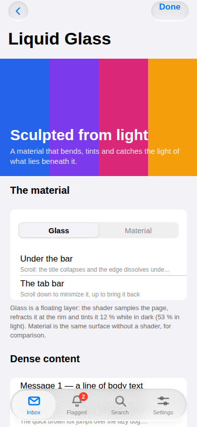
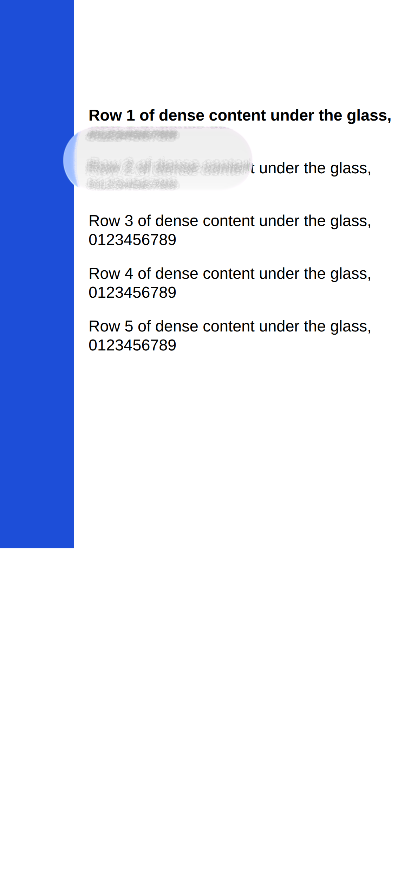

[English](glass.md)

# Glass（液态玻璃）

Apple iOS 26 的材质：一件覆在身后内容之上的玻璃。表面通过 GPU shader 读取背后的画面，用圆角矩形高度场弯折它（边缘折射并放大紧贴形状外侧的内容，中间保持平整），再模糊、按变体着色，并加上一条受光照方向影响的高光环。绘制在其上的内容依然锐利：平台绘制子元素，shader 只在它们下方绘制材质。

| | |
| --- | --- |
| 浅色，内容从下方滚过 |  |
| 深色 |  |
| 无玻璃 / 无 GPU 时的材质 / shader |  |

## `Glass`

| TSX | Rust | 类型 | 默认 | |
| --- | --- | --- | --- | --- |
| `shape` | `.shape(..)` | `"rounded" \| "capsule" \| "circle"` | `"rounded"` | 轮廓 |
| `radius` | `.radius(..)` | `number` | `0` | `"rounded"` 的圆角，单位 pt |
| `variant` | `.variant(..)` | `"regular" \| "clear" \| "thick" \| "interactive" \| "tinted"` | `"regular"` | 外观 |
| `tint` | `.tint(..)` | `string` | `system-blue` | `"tinted"` 使用的 token |
| `light` | `.light(..)` | `number` | `225` | 光照方向，单位度 |
| `quality` | `.quality(..)` | `"high" \| "balanced" \| "low"` | `"balanced"` | 模糊采样数：17、9 或 1 |
| `interactive` | `.interactive(..)` | `boolean` | `false` | 是否响应按压 |
| `children` | | 内容 | | 绘制在玻璃之上的内容 |

## `GlassButton`

| TSX | Rust | 类型 | 默认 | |
| --- | --- | --- | --- | --- |
| `title` | `.title(..)` | `string` | 无 | 文字 |
| `icon` | `.icon(..)` | `string` | 无 | 文字前的图标 |
| `label` | `.label(..)` | `string` | 标题 | 读屏名称 |
| `disabled` | `.disabled(..)` | `boolean` | `false` | 变暗且不可按压 |

事件：`onPress()`。

## `GlassGroup`

| TSX | Rust | 类型 | 默认 | |
| --- | --- | --- | --- | --- |
| `shapes` | `.shapes(..)` | `GlassRect[]` | `[]` | 一到两个形状 |
| `mergedShapes` | `.merged_shapes(..)` | `GlassRect[]` | `shapes` | 融合后的位置 |
| `merged` | `.merged(..)` | `boolean` | `false` | 是否融合 |
| `spacing` | `.spacing(..)` | `number` | `0` | 相距多少仍会融合 |
| `variant` | `.variant(..)` | `string` | `"regular"` | 外观 |
| `children` | | 内容 | | 绘制在玻璃之上的内容 |

`GlassRect`：`{ x, y, width, height, radius }`，单位为相对组左上角的 pt；半径 `-1` 表示胶囊，`-2` 表示圆形。

## 开销

- 静态表面只绘制**一次**：shader 不读取 `nsh.time`。尺寸、uniform 或背后的画面变化（滚动、动画值、变体切换）时才重绘。
- `quality` 用采样数换性能：`"high"` 17 次、`"balanced"` 9 次、`"low"` 1 次（自身不模糊，由着色承担材质，用于弱 GPU）。
- `interactive` 表面在 UI 线程上动画：按压缩仅是一个动画值，镜头强度、高光扩散和压缩比例都由它派生，应用代码每帧无需参与。
- 镜头与模糊会读取盒子外 `maxSampleOffset` 个点的画面（镜头厚度加模糊半径），因此平台会保留比表面大出这些点的画面。这也是该材质是 *effect* 而不是 fill 的原因：fill 的画面在 iOS 上止于自身盒子，在 Web 上会被压缩进盒子。

## 使用场合

只用于浮动层：内容之上的导航栏、标签栏、sheet、操作表、弹窗、菜单、浮动控件。绝不放在内容背后，也绝不放在承受不起对比度下降的文字背后——列表行、邮件正文。HIG（*Materials*、*Liquid Glass*）对此说得很明确，材质自身的可读性规则也以此为前提。

## 平台

| | |
| --- | --- |
| iOS、macOS、Windows、Linux、Android | wgpu（Metal、Vulkan、Direct3D 12、OpenGL）：shader 绘制材质，平台在它之上绘制内容。Android 由 CI 验证：API 34 模拟器用 SwiftShader 拍摄这些页面并测量透镜效果（[`android-glass-*.png`](https://github.com/markbang/nsh-cupertino/tree/screenshots/main)）。 |
| Web | 通过 NSH 运行时的 WebGL 2。在 NSH 修复两个阶段的 uniform block 绑定之前，材质需要 `tools/patch-runtime.mjs` 的修复（见 `docs/design-notes.md`）；没有它，Web 上的 shader 什么都画不出来。 |
| 无 GPU（没有 WebGL 2 的浏览器、未启用 shader 编译器的构建、终端） | 退化为材质自身的填充与背景模糊（`tokens::materials`），与 shader 之前导航栏所用的完全一致：`tokens::glass` 与 `tokens::materials` 在观感上对齐，其他都不变。 |
| 降低动态效果 | 按压保留数值、去掉弹簧；sheet 的入场仍按原有动画。 |
| 增强对比度 | 玻璃填充来自 `tokens::glass`，跟随 `Theme` 的 `contrast="high"`：接近不透明，符合 HIG 对无法保证对比度时玻璃的要求。 |

## 说明

- 变体：`regular` 用于栏，`thick` 用于文字（sheet、弹窗），`clear` 仅用于媒体，`interactive` 用于控件，`tinted` 用于单一操作。
- 当背景会与文字"打架"时（深色玻璃下的亮画面、浅色玻璃下的暗画面），着色会自行加厚到最多 96%。这就是 Apple 材质中"自适应"的部分，也是导航栏压在照片上仍能读清文字的原因。
- 高光环跟随 `light`（角度，225 表示左上）以及应用驱动的 `tilt` 角度；NSH 不提供设备姿态，因此倾斜由应用给出。
- `GlassGroup` 把 Apple 的 `GlassEffectContainer` 理解为"一个 shader 画两个矩形"。它不会在两个布局之间迁移形状的*内容*，且最多支持两个形状。

## 无障碍

- `Glass` 是装饰：除非 `interactive`，否则不接受按压，也没有名称。
- `GlassButton` 是按钮：有标签、禁用状态和 `onPress`；按压同时伴随缩放反馈，读屏用户得到同样的结果。
- 材质从不移动文字：`Reduce Motion` 去掉压缩与弹簧，数值直接到位。
