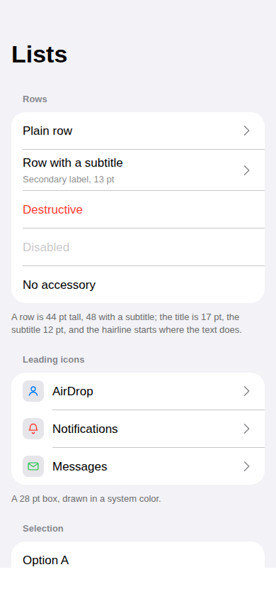
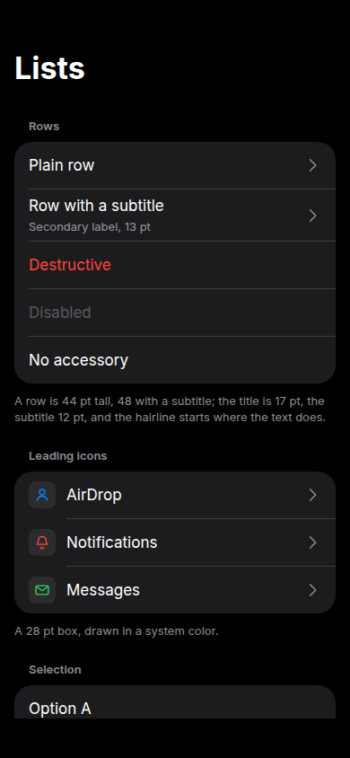

[简体中文](icon.zh-CN.md)

# Icons

NSH has no SF Symbols; this crate draws the shapes it needs as SVG in the
element's text color, so they follow the theme and the contrast setting. The set
covers what a bar, a list row and a mail app's actions draw; a shape that is not
here is a shape to add, not to draw in the app.

| | |
| --- | --- |
| Light |  |
| Dark |  |

```rust
icon("chevron.right", 13.0);          // 2.4 pt line, at 24 pt
icon_stroke("checkmark", 18.0, 3.0);  // a heavier line, as iOS draws a tick
```

In TSX, components take an icon by name: `<ListTile leading="bell" />`,
`<Button icon="arrow.up.right" />`. For an icon that is part of a row or a bar
rather than of a control, use `Icon`:

```tsx
<Icon name="paperclip" size={16} tint="secondary-label" />
<Icon name="flag.fill" tint="system-red" label="Flagged" />
```

| TSX | Rust | Type | Default | |
| --- | --- | --- | --- | --- |
| `name` | `.name(..)` | string | none | A name from the table below |
| `size` | `.size(..)` | number | 20 | Its side in points |
| `tint` | `.tint(..)` | token name | `label` | `secondary-label`, `system-blue`, `system-red`, ... |
| `label` | `.label(..)` | string | none | What screen readers say; leave it out beside text that already names it |

| Name | |
| --- | --- |
| `chevron.left`, `chevron.right`, `chevron.up`, `chevron.down` | Navigation |
| `checkmark`, `checkmark.circle` | A chosen row, a finished job |
| `xmark`, `xmark.circle.fill`, `ellipsis`, `plus` | Clear, close, more, add |
| `magnifyingglass` | Search |
| `eye`, `eye.slash` | Reveal a password |
| `person`, `person.crop.circle`, `bell`, `envelope`, `envelope.open` | People, notifications, mail |
| `tray`, `paperplane`, `archivebox`, `trash`, `flag`, `flag.fill`, `paperclip` | Inbox, send, archive, delete, flag, attachments |
| `folder`, `square.and.pencil`, `pencil`, `clock`, `calendar` | Mailboxes, compose, edit, schedules |
| `arrow.clockwise`, `arrowshape.turn.up.left`, `arrowshape.turn.up.right`, `arrow.up.right` | Refresh, reply, forward, open |
| `link`, `key`, `line.3.horizontal.decrease` | Links, keys, filters and rules |
| `sun.max`, `moon`, `cloud`, `circle.lefthalf.filled` | Appearance and state |
| `square.grid.2x2`, `list.bullet`, `slider.horizontal.3` | Sections and settings |
| `info.circle`, `sparkles`, `exclamationmark.triangle` | Notes, highlights, failures |
| `doc`, `photo` | Files and images |

Unknown names draw nothing (and log), so a typo is visible rather than loud.

## Accessibility

An icon has no text: give the control around it a `label`, which the components
do ("Clear text", "Show text"). Standalone icons that carry meaning take
`<Icon label="Flagged" />`; decorative ones take none.
