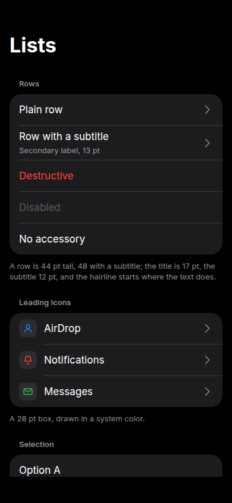

[English](icon.md)

# 图标

NSH 没有 SF Symbols；这个 crate 把需要的形状画成 SVG，使用元素的文字颜色，所以它们会跟随主题与对比度设置。
这套图标覆盖栏、列表行和邮件应用动作要画的东西；没有的形状应当加到这里，而不是在应用里另画。

| | |
| --- | --- |
| 浅色 |  |
| 深色 |  |

```rust
icon("chevron.right", 13.0);          // 24 pt 下 2.4 pt 线宽
icon_stroke("checkmark", 18.0, 3.0);  // 更粗的线，像 iOS 的勾
```

TSX 里组件按名字接收图标：`<ListTile leading="bell" />`、`<Button icon="arrow.up.right" />`。
图标属于一行或一条栏、而不是某个控件时，用 `Icon`：

```tsx
<Icon name="paperclip" size={16} tint="secondary-label" />
<Icon name="flag.fill" tint="system-red" label="Flagged" />
```

| TSX | Rust | 类型 | 默认 | |
| --- | --- | --- | --- | --- |
| `name` | `.name(..)` | string | 无 | 下表里的名字 |
| `size` | `.size(..)` | number | 20 | 边长（pt） |
| `tint` | `.tint(..)` | token 名 | `label` | `secondary-label`、`system-blue`、`system-red` …… |
| `stroke` | `.stroke(..)` | number | 2.4 | 按 24 pt 计的线宽：2.4 是 SF Symbols 的 regular；1.5 画控件的细线图标 |
| `label` | `.label(..)` | string | 无 | 读屏读到的文字；旁边已有文字命名它时不写 |

| 名称 | |
| --- | --- |
| `chevron.left`、`chevron.right`、`chevron.up`、`chevron.down` | 导航 |
| `checkmark`、`checkmark.circle` | 已选中的行、完成 |
| `xmark`、`xmark.circle.fill`、`ellipsis`、`plus` | 清除、关闭、更多、添加 |
| `magnifyingglass` | 搜索 |
| `eye`、`eye.slash` | 显示密码 |
| `person`、`person.crop.circle`、`bell`、`envelope`、`envelope.open` | 人、通知、邮件 |
| `tray`、`paperplane`、`archivebox`、`trash`、`flag`、`flag.fill`、`paperclip` | 收件箱、发送、归档、删除、标记、附件 |
| `folder`、`square.and.pencil`、`pencil`、`clock`、`calendar` | 邮箱、写邮件、编辑、定时 |
| `arrow.clockwise`、`arrowshape.turn.up.left`、`arrowshape.turn.up.right`、`arrow.up.right` | 刷新、回复、转发、打开 |
| `link`、`key`、`line.3.horizontal.decrease` | 链接、密钥、筛选与规则 |
| `sun.max`、`moon`、`cloud`、`circle.lefthalf.filled` | 外观与状态 |
| `palette`、`globe`、`arrow.up.right.square`、`chevron.up.down` | 设置行：外观、网站、外链、取值选择 |
| `square.grid.2x2`、`list.bullet`、`slider.horizontal.3` | 分区与设置 |
| `info.circle`、`sparkles`、`exclamationmark.triangle` | 说明、亮点、失败 |
| `doc`、`photo` | 文件与图片 |

未知名字不画任何东西（并记录日志），所以拼写错误看得见，而不是报错。

## 无障碍

图标没有文字：给包住它的控件一个 `label`，组件本身已经这么做（"Clear text"、"Show text"）。
有含义的独立图标用 `<Icon label="Flagged" />`；纯装饰的不写。
