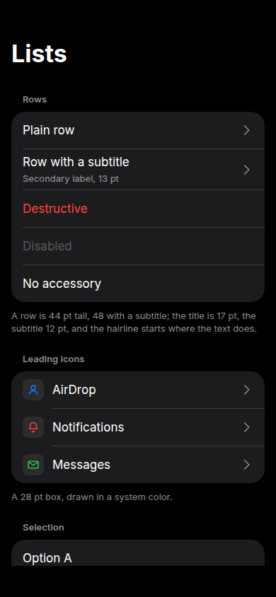

[简体中文](list.zh-CN.md)

# Lists: `List`, `Section`, `ListTile`

iOS's inset grouped lists: rows on one 20 pt surface with 16 pt page margins,
hairline separators that start where the text starts, a chevron for a row that
opens something and a checkmark for a chosen one.

The values are the iOS reference's, measured from its pixels (Cohub Mobile's
settings rows): 16 pt margins, a 13 pt group header 32 pt from the edge, a 13 pt
footer in the header/footer color, 52 pt rows (57 with a subtitle), a 17 pt
title, a 13 pt subtitle, 16 pt row insets and a 30 pt leading tile, so the text
and the separator start 58 pt from the card's edge.

| | |
| --- | --- |
| Light |  |
| Dark |  |

## List

A whole page of sections: the background, the safe area, the 16 pt margins and
iOS's bouncing.

| TSX | Rust | Type | Default | |
| --- | --- | --- | --- | --- |
| `children` | `.child(..)` | JSX | — | The sections |
| `background` | `.background(..)` | token name | `system-grouped-background` | Behind the sections |
| `scroll` | `.scroll(..)` | `boolean` | `true` | `false` inside `NavPage`, whose scroll already runs the page |

## Section

A group of rows on one surface, with an optional header above and footer below.

| TSX | Rust | Type | Default | |
| --- | --- | --- | --- | --- |
| `header` | `.header(..)` | `string` | none | 13 pt bold in the secondary label, 32 pt from the edge, 16 pt above, 10 pt below |
| `footer` | `.footer(..)` | `string` | none | 13 pt in the header/footer color, 10 pt below |
| `children` | `.child(..)` | JSX | — | The rows |

## ListTile

A row: 52 pt tall (57 with a subtitle), 16 pt insets, title at 17 pt, subtitle
at 13 pt. A leading icon sits on a 30 pt tile in `system-gray5` (red with a white
icon when `destructive`).

| TSX | Rust | Type | Default | |
| --- | --- | --- | --- | --- |
| `title` | `.title(..)` | `string` | none | The row's title, 17 pt |
| `subtitle` | `.subtitle(..)` | `string` | none | A line under the title, 13 pt secondary label, 3 pt below it |
| `leading` | `.leading(..)` | icon name | none | A 30 pt tile with an 18 pt line icon |
| `leadingColor` | `.leading_color(..)` | token name | `secondary-label` | The icon's color (`system-blue` for an `accent` row) |
| `accessory` | `.accessory(..)` | `"chevron"` \| `"checkmark"` \| `"none"` | chevron | At the trailing edge |
| `align` | `.align(..)` | `"top"` | centred | `top`: 60 pt, title and trailing controls 8 pt from the top, the tile stays centred (a switch with a detail beside it) |
| `checked` | `.checked(..)` | `boolean` | `false` | Shows a checkmark and sets the row's state |
| `destructive` | `.destructive(..)` | `boolean` | `false` | Red title; with a leading icon, a red tile with a white icon |
| `accent` | `.accent(..)` | `boolean` | `false` | Blue title and icon: an action such as "Add item" |
| `separator` | `.separator(..)` | `boolean` | `true` | The hairline under the row |
| `disabled` | `.disabled(..)` | `boolean` | `false` | Dimmed, not pressable |
| `children` | `.child(..)` | JSX | none | A control at the trailing edge: `<ListTile title="Wi-Fi"><Switch/></ListTile>` |

Events: `onPress`.

## Separators

Every row but the last of its group draws a hairline, whatever the row is: a
plain row, a subtitle, a destructive or disabled row, a leading icon, a chevron,
a checkmark selection. The line starts where the text starts (58 pt from the card's edge after a
leading tile, 16 pt otherwise) and is one **device pixel**:

```text
thickness = round(max(configured * pixelRatio, 1)) / pixelRatio
```

With the configured 0.33 pt that is 0.33 pt at @3x, 0.5 pt at @2x and 1 pt at
1x. Without the floor a 1x display rounds the line away, which is what left rows
without a separator on the web. Set `separator={false}` only on the last row of a
group; an empty group draws none.

Notes

- Rows draw their own hairline; give the last row of a group `separator={false}`.
- The hairline starts where the text starts: 58 pt in after a leading tile, 16 pt otherwise.
- The pressed highlight is `systemGrey4`, as `CupertinoListTile` fills it, not a
  scale.
- A row with no `accessory` shows a chevron: pass `accessory="none"` for a row
  that opens nothing. The chevron is a 1.5 pt line in the secondary label.
- A destructive row is red in the `danger` role: the system red, or the preset's
  when `Theme` sets one.

## Accessibility

- Each row is a button named "title. subtitle"; `disabled` and `checked` reach the
  screen reader, and the checkmark row reports itself as selected.
- Sections are groups, the list is a list, headers are headers at level 2.
- Tab reaches every pressable row; Space and Return press it.

## Motion

The pressed highlight is native and immediate. Rows do not animate; the content
that opens from them does (the app's own navigation or sheet).
