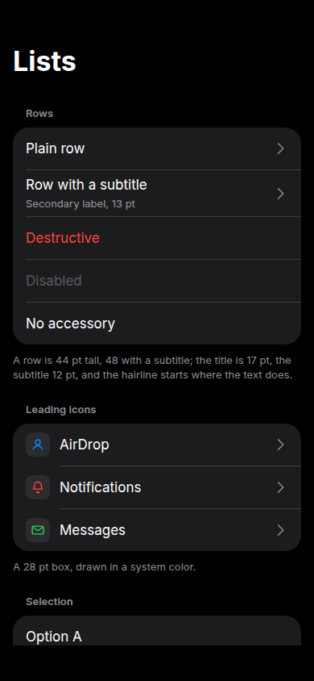

[English](list.md)

# 列表：`List`、`Section`、`ListTile`

iOS 的分组内嵌列表：行在一整块 20 pt 圆角表面上，页面边距 16 pt，细线从文字开始的位置起，
能打开的行走右箭头，已选中的行显示勾选。

数值取自 iOS 参考图的像素（Cohub Mobile 的设置行）：16 pt 边距、距边缘 32 pt 的 13 pt 分组标题、
header/footer 色的 13 pt 脚注、52 pt 行（带副标题 57 pt）、17 pt 标题、13 pt 副标题、16 pt 行内边距，
以及 30 pt 前置图标块，因此文字与分隔线都从卡片边缘 58 pt 处开始。

| | |
| --- | --- |
| 浅色 |  |
| 深色 |  |

## List

一整页的分组：背景、安全区、16 pt 边距以及 iOS 的回弹。

| TSX | Rust | 类型 | 默认值 | |
| --- | --- | --- | --- | --- |
| `children` | `.child(..)` | JSX | — | 各分组 |
| `background` | `.background(..)` | token 名 | `system-grouped-background` | 分组背后的颜色 |
| `scroll` | `.scroll(..)` | `boolean` | `true` | 放在 `NavPage` 内时传 `false`，由页面的滚动承担 |

## Section

一组行放在同一块表面上，可选上方 header 与下方 footer。

| TSX | Rust | 类型 | 默认值 | |
| --- | --- | --- | --- | --- |
| `header` | `.header(..)` | `string` | 无 | 13 pt 半粗体（semibold）、secondary label，距边缘 32 pt，上方 16 pt、下方 10 pt |
| `footer` | `.footer(..)` | `string` | 无 | 13 pt、header/footer 色，下方 10 pt |
| `children` | `.child(..)` | JSX | — | 各行 |

## ListTile

一行：高 52 pt（带副标题 57 pt），左右内边距 16 pt，标题 17 pt，副标题 13 pt。前置图标放在 30 pt 的 `system-gray5` 图块上（`destructive` 时为红块、白色图标）。

| TSX | Rust | 类型 | 默认值 | |
| --- | --- | --- | --- | --- |
| `title` | `.title(..)` | `string` | 无 | 标题，17 pt |
| `subtitle` | `.subtitle(..)` | `string` | 无 | 标题下的一行，13 pt secondary label，间距 3 pt |
| `leading` | `.leading(..)` | 图标名 | 无 | 30 pt 图块里 18 pt 线条图标 |
| `leadingColor` | `.leading_color(..)` | token 名 | `secondary-label` | 图标颜色（`accent` 行为 `system-blue`） |
| `accessory` | `.accessory(..)` | `"chevron"` \| `"checkmark"` \| `"none"` | chevron | 右侧附件 |
| `align` | `.align(..)` | `"top"` | 居中 | `top`：高 60 pt，标题与右侧控件距顶 8 pt，前置图块保持居中（右侧是带详情的开关） |
| `checked` | `.checked(..)` | `boolean` | `false` | 显示勾选，并设置行的读屏状态 |
| `destructive` | `.destructive(..)` | `boolean` | `false` | 红色标题；带前置图标时为红色图块、白色图标 |
| `accent` | `.accent(..)` | `boolean` | `false` | 蓝色标题与图标，用于"添加项"这类操作 |
| `separator` | `.separator(..)` | `boolean` | `true` | 行下的细线 |
| `disabled` | `.disabled(..)` | `boolean` | `false` | 变灰，不可按下 |
| `children` | `.child(..)` | JSX | 无 | 行尾的控件：`<ListTile title="Wi-Fi"><Switch/></ListTile>` |

事件：`onPress`。

## 分隔线

分组中除最后一行外，每一行都画一条细分隔线，与行的种类无关：普通行、带副标题、破坏性、禁用、带前置图标、带箭头、勾选选中都一样。线从文字开始处起（有前置图块时距卡片边缘 58 pt，否则 16 pt），厚度是一台**设备像素**：

```text
thickness = round(max(configured * pixelRatio, 1)) / pixelRatio
```

配置值为 0.33 pt 时，@3x 为 0.33 pt，@2x 为 0.5 pt，1x 为 1 pt。没有下限时，1x 屏幕会把线四舍五入掉，这正是网页上部分行没有分隔线的原因。只在分组最后一行传 `separator={false}`；空分组不画线。

说明

- 行自己绘制细线；分组最后一行传 `separator={false}`。
- 细线从文字开始处起：有前置图块时距卡片边缘 58 pt，否则 16 pt。
- 按压高亮是 `systemGrey4`（与 `CupertinoListTile` 一致），不是缩放。
- 没传 `accessory` 的行会显示右箭头：不打开任何东西的行传 `accessory="none"`。箭头是 1.5 pt 的线，颜色为 `secondary-label`。
- 破坏性行的红色取自 `danger` 角色：系统红色，或 `Theme` 设定的预设值。

## 无障碍

- 每行是按钮，名称为"标题。副标题"；`disabled` 与 `checked` 会传给读屏，勾选行会报告为已选中。
- 分组是 group，列表是 list，分组标题是层级 2 的 header。
- Tab 能到达每个可按下行；空格与回车可以按下。

## 动效

按压高亮由平台原生即时绘制。行本身不做动画；从行打开的内容（应用自己的导航或 Sheet）才有动画。
