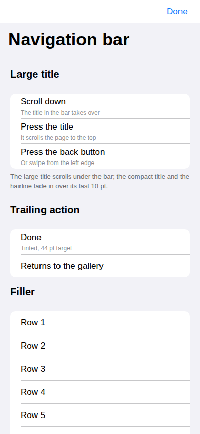

[简体中文](navigation-bar.zh-CN.md)

# Navigation bar

A page's bar, and the whole page with it: a back button, a title that is compact
or large, trailing actions, and a hairline that appears once content scrolls
under it.

| | |
| --- | --- |
| Light |  |
| Dark |  |

## NavPage

`NavPage` is the page: the bar as a layer over a scrolling view. The content runs
to the top edge, padded by the bar's height and the safe area, so it scrolls
under the bar rather than stopping at its edge: with a `material` the glass
samples the rows there. Its large title is the first thing in the scroll content,
so it scrolls away under the bar; the compact title and the hairline fade in over
its last 10 pt. The fade is driven by the scroll offset natively (`scrollValue` +
an interpolation), so no frame of the scroll reaches your code.

| TSX | Rust | Type | Default | |
| --- | --- | --- | --- | --- |
| `title` | `.title(..)` | `string` | none | The bar's title; the compact one when there is a `largeTitle` |
| `largeTitle` | `.large_title(..)` | `string` | none | 34 pt bold heading that scrolls away |
| `back` | `.back(..)` | `string` | none | The back button's label; without it there is no back button |
| `trailing` | `.trailing(..)` | `string` | none | A tinted trailing action ("Done", "Edit") |
| `background` | `.background(..)` | token name | `system-grouped-background` | The page's background |
| `material` | `.material(..)` | `"opaque"` \| `"regular"` \| `"thin"` \| `"ultra-thin"` \| `"thick"` \| `"chrome"` | `opaque` | The bar's surface: opaque, or a material that lenses and blurs the content scrolling under it |
| `refreshing` | `.refreshing(..)` | `boolean` | `false` | A pull to refresh runs: the indicator stays below the bar |
| `children` | `.child(..)` | JSX | — | The page's content |

Events: `onBack`, `onTrailing`, `onRefresh`.

Notes

- The bar is 44 pt tall, padded 16 pt at the sides; the large title adds 52 pt.
  Both are minimums: large text grows them instead of clipping it.
- The back button is a chevron at 20 pt with 6 pt before its label, and its
  target is 50 pt wide, as `CupertinoNavigationBarBackButton` draws it.
- Pulling past the top asks for a refresh (`onRefresh`); `refreshing` pins the
  activity indicator below the bar.
- The hairline is one device pixel at every scale, the same rule as
  [the lists](list.md#separators).
- The bar floats over the content on every platform, with or without a material:
  the content's top padding is the bar plus the safe area, and it scrolls under
  the bar from the first frame. The compact title takes over 44 pt into the
  scroll.
- Pressing the title scrolls the page back to the top, as iOS does.
- Safe area: the bar draws behind the status bar and pads its row by the inset;
  the content is padded by the bar plus the inset, and ends above the home
  indicator.

## NavigationBar

The bar alone, for content you scroll yourself: a compact title, an optional large
title below it, a back button and a slot for trailing actions.

| TSX | Rust | Type | Default | |
| --- | --- | --- | --- | --- |
| `title` | `.title(..)` | `string` | none | The compact title |
| `largeTitle` | `.large_title(..)` | `string` | none | A large title below the bar |
| `back` | `.back(..)` | `string` | none | Back button label |
| `trailing` | `.trailing(..)` | JSX | none | Anything at the trailing edge |
| `collapsed` | `.collapsed(..)` | `number` 0–1 | `0` | Fades the compact title and the hairline in |
| `material` | `.material(..)` | material name | `opaque` | A translucent bar over a blur, for content that scrolls under it |

Events: `onBack`.

## Accessibility

- The large title is a header at level 1; screen reader users can jump to it.
- The back button is a button named by its label ("Cupertino"), 44 pt tall.
- The title in `NavPage` is pressable (scroll to top) and carries the page's name
  as its label, so the heading is never only visual.

## The back gesture

`NavPage` draws a back button but registers no back handler: on Android the
system gesture stays the platform's, and Escape on the desktops is the app's to
handle. Wire both to your own history in one place — the app root's `onBackPress`
(`nsh`), or a `NavStack` page's `on_dismiss` — and let `NavPage` only draw.

## Motion

The compact title and hairline fade over the last 10 pt of the large title's
52 pt; nothing animates on its own. Pushing a page uses iOS's
`kTransitionDuration` (500 ms) spring, which NSH's navigation stack plays when the
app uses one.

## The floating bar

With a `material`, `NavPage` draws iOS 26's floating group instead of a
full-width band: a 40 pt circular glass back button 16 pt from the leading edge,
the compact title in the middle, and the trailing action in a glass capsule 16 pt
from the trailing edge, 8 pt below the safe area. The large title stays in the
content and collapses into the group as it scrolls away; a `ScrollEdge` behind
them dissolves what passes under (0 at rest, full after 26 pt of scroll). The
page's content keeps its top inset (bar height plus safe area) and scrolls under
all of it; content is also visible in the gaps either side of the trailng
capsule.
