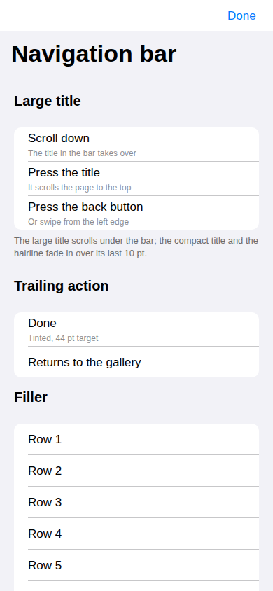
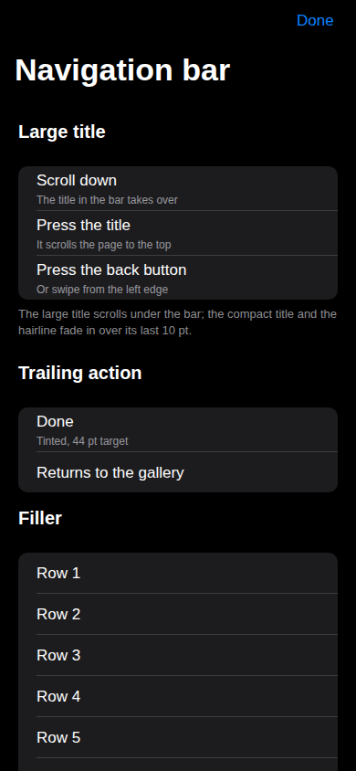

# 导航栏

页面的栏，以及整页本身：返回按钮、可大可小的标题、右侧操作，以及内容滚动到栏下方时出现的细线。

| | |
| --- | --- |
| 浅色 |  |
| 深色 |  |

## NavPage

`NavPage` 就是整页：栏 + 滚动视图。大标题是滚动内容的第一项，所以它会滚到栏下面；紧凑标题与
细线在大标题最后 10 pt 内淡入。淡入由滚动偏移在原生侧驱动（`scrollValue` + 插值），滚动的
每一帧都不会回到你的代码里。

| TSX | Rust | 类型 | 默认值 | |
| --- | --- | --- | --- | --- |
| `title` | `.title(..)` | `string` | 无 | 栏里的标题；有 `largeTitle` 时是紧凑标题 |
| `largeTitle` | `.large_title(..)` | `string` | 无 | 随滚动离开的 34 pt 粗体大标题 |
| `back` | `.back(..)` | `string` | 无 | 返回按钮的文案；不传就没有返回按钮 |
| `trailing` | `.trailing(..)` | `string` | 无 | 右侧着色操作（"完成"、"编辑"） |
| `background` | `.background(..)` | token 名 | `system-grouped-background` | 页面背景 |
| `children` | `.child(..)` | JSX | — | 页面内容 |

事件：`onBack`、`onTrailing`。

说明

- 栏高 44 pt，左右内边距 16 pt；大标题额外占 52 pt。
- 按下标题会把页面滚回顶部，与 iOS 一致。
- 安全区：页面自己处理顶部 inset；内容结束在 home indicator 之上。

## NavigationBar

单独的栏，用于你自己控制滚动的页面：紧凑标题、可选的大标题、返回按钮，以及右侧插槽。

| TSX | Rust | 类型 | 默认值 | |
| --- | --- | --- | --- | --- |
| `title` | `.title(..)` | `string` | 无 | 紧凑标题 |
| `largeTitle` | `.large_title(..)` | `string` | 无 | 栏下方的大标题 |
| `back` | `.back(..)` | `string` | 无 | 返回按钮文案 |
| `trailing` | `.trailing(..)` | JSX | 无 | 右侧任意内容 |
| `collapsed` | `.collapsed(..)` | `number` 0–1 | `0` | 让紧凑标题与细线淡入 |

事件：`onBack`。

## 无障碍

- 大标题是层级 1 的 header，读屏用户可以跳到它。
- 返回按钮是按钮，名称就是它的文案（如 "Cupertino"），高度 44 pt。
- `NavPage` 里的标题可按下（回顶部），并以页面名作为无障碍名称，所以标题不会只存在于视觉上。

## 动效

紧凑标题与细线在大标题 52 pt 的最后 10 pt 内淡入；没有其它自动播放的动画。页面推入使用 iOS 的
`kTransitionDuration`（500 ms）弹簧，由 NSH 的导航栈在应用使用时播放。
