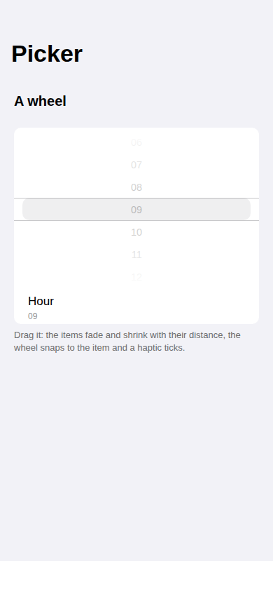
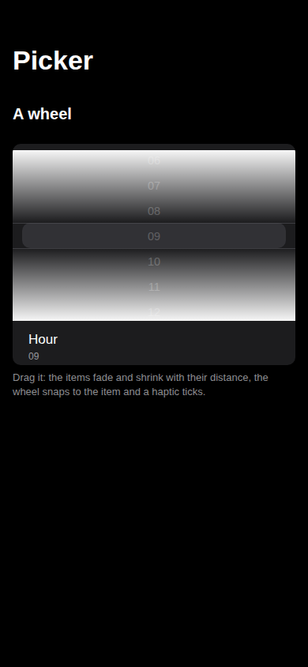

[简体中文](picker.zh-CN.md)

# Picker

iOS's wheel: a vertical list that snaps to an item, with the items above and
below fading and shrinking, and a selection band behind the centre row. A new
item ticks with a haptic.

| | |
| --- | --- |
| Light |  |
| Dark |  |

| TSX | Rust | Type | Default | |
| --- | --- | --- | --- | --- |
| `items` | `.items(..)` | `PickerItem[]` | `[]` | The values, top to bottom |
| `value` | `.value(..)` | `string` | first | The chosen value, controlled |
| `itemHeight` | `.item_height(..)` | `number` | `32` | Row height in points |
| `height` | `.height(..)` | `number` | `216` | Wheel height |
| `label` | `.label(..)` | `string` | `"Picker"` | What screen readers call it |

`PickerItem`: `{ value, title }`.

Events: `onChange(value, index)`.

Notes

- The wheel is a native scroll with `snapToInterval`: the platform snaps, so no
  frame of the drag reaches Rust. Each item's scale and opacity are bound to the
  scroll offset, so the fade runs on the UI thread too.
- Pressing an item scrolls it to the centre. The app's `value` scrolls the
  wheel when it changes.
- The selection band is `tertiaryFill`, the row labels 20 pt.

## Accessibility

- Role adjustable with a name; a screen reader can read the selected value.
- The wheel follows the platform's scroll gestures, including reduced motion
  (the scroll jumps rather than animating).

## Motion

The snap and the press-to-scroll use the platform's scroll; the fade is a
function of the offset — no timer.
