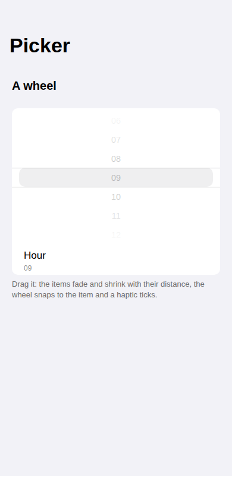
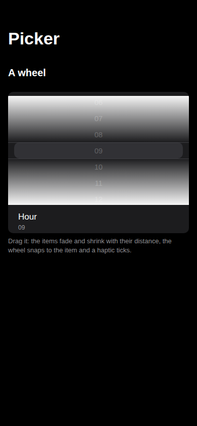

[English](picker.md)

# 滚轮 Picker

iOS 的滚轮：可吸附的纵向列表，上下项随距离缩小、变淡，中间有选中带；每次换项有一次触感。

| | |
| --- | --- |
| 浅色 |  |
| 深色 |  |

| TSX | Rust | 类型 | 默认 | |
| --- | --- | --- | --- | --- |
| `items` | `.items(..)` | `PickerItem[]` | `[]` | 从上到下的值 |
| `value` | `.value(..)` | `string` | 第一项 | 受控的选中值 |
| `itemHeight` | `.item_height(..)` | `number` | `32` | 行高（pt） |
| `height` | `.height(..)` | `number` | `216` | 滚轮高度 |
| `label` | `.label(..)` | `string` | `"Picker"` | 无障碍名称 |

`PickerItem`：`{ value, title }`。

事件：`onChange(value, index)`。

说明

- 滚轮是原生滚动加 `snapToInterval`，吸附由平台完成，拖动不经过 Rust；每项的缩放和透明度绑定在滚动偏移上，也在 UI 线程运行。
- 点击某一项会滚到中间；应用修改 `value` 时滚轮跟随。
- 选中带为 `tertiaryFill`，文字 20 pt。

## 无障碍

- 角色为 adjustable，并带名称；读屏可读出选中值。
- 滚动手势跟平台一致；减弱动态效果时滚动直接跳转。

## 动效

吸附与点击滚动使用平台滚动；淡入淡出是偏移的函数，不依赖定时器。
