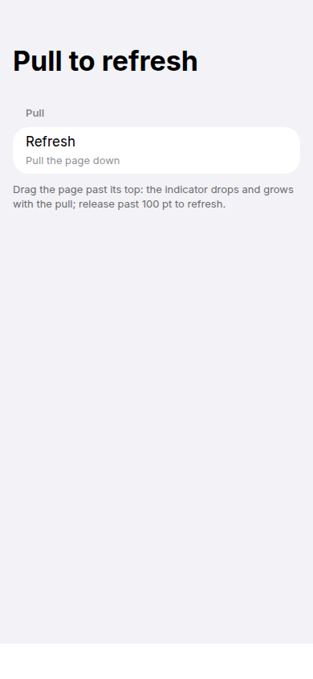
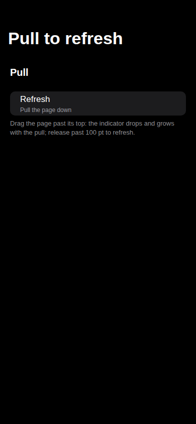

[简体中文](refresh.zh-CN.md)

# Pull to refresh

A scrolling page whose pull past its top drops an activity indicator with the
drag; releasing past 100 pt asks for a refresh, and the indicator stays out
while it runs.

| | |
| --- | --- |
| Light |  |
| Dark |  |

| TSX | Rust | Type | Default | |
| --- | --- | --- | --- | --- |
| `children` | `.child(..)` | JSX | — | The scrolling content |
| `refreshing` | `.refreshing(..)` | `boolean` | `false` | A refresh runs |
| `background` | `.background(..)` | token name | `system-grouped-background` | Behind the content |
| `tint` | `.tint(..)` | token name | `tertiary-label` | The indicator's color |

Events: `onRefresh()`.

Notes

- The indicator's translation, scale and opacity are derived from the scroll
  offset, so the drag never waits for Rust; a manual refresh pins it with a
  spring.
- `NavPage` has the same pull: give it `refreshing` and follow `onRefresh`, and
  the indicator sits below the bar.
- Releasing past 100 pt ticks with a light haptic on touch screens.

## Accessibility

- The indicator is a progress indicator named "Pull to refresh"; while a refresh
  runs the page announces it. The content stays a normal scroll for screen
  readers.

## Motion

The indicator follows the finger; a manual refresh springs it to 60 pt. Reduce
Motion keeps the same offsets (the spinner shows a still frame).
