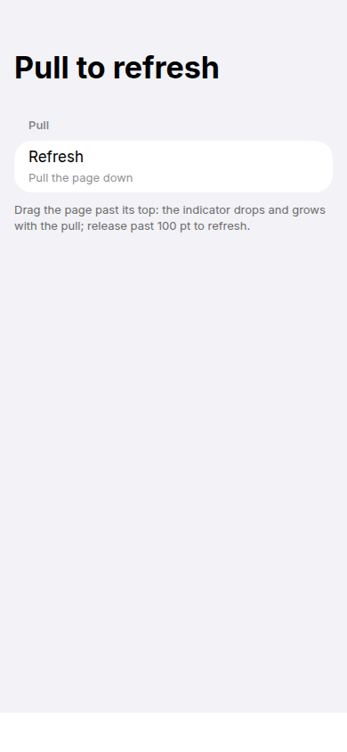

[English](refresh.md)

# 下拉刷新 Pull to refresh

可滚动的页面：从顶部下拉时活动指示器随拖动落下并放大；超过 100 pt 释放即请求刷新，刷新期间指示器保持展开。

| | |
| --- | --- |
| 浅色 |  |
| 深色 |  |

| TSX | Rust | 类型 | 默认 | |
| --- | --- | --- | --- | --- |
| `children` | `.child(..)` | JSX | — | 滚动内容 |
| `refreshing` | `.refreshing(..)` | `boolean` | `false` | 刷新进行中 |
| `background` | `.background(..)` | token 名 | `system-grouped-background` | 内容背景 |
| `tint` | `.tint(..)` | token 名 | `tertiary-label` | 指示器颜色 |

事件：`onRefresh()`。

说明

- 指示器的位移、缩放和透明度都由滚动偏移推导，拖动不必等 Rust；手动刷新时用弹簧把它固定在 60 pt。
- `NavPage` 也有同样的下拉：传入 `refreshing` 并响应 `onRefresh`，指示器出现在导航栏下方。
- 超过 100 pt 释放时，触屏会给一次轻触感。

## 无障碍

- 指示器是名为"Pull to refresh"的 progress indicator；刷新期间页面会说明正在刷新。内容仍是普通滚动区域。

## 动效

指示器跟随手指；手动刷新时弹到 60 pt。减弱动态效果保持相同位移（指示器显示静止画面）。
