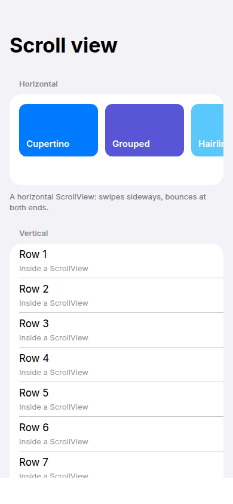
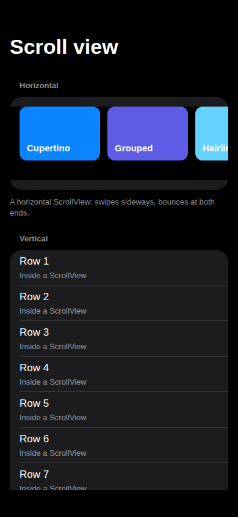

# Scroll view

A native scroll view with iOS's behavior: content that bounces at its ends, the
platform's scroll indicator, and a keyboard that follows the drag.

| | |
| --- | --- |
| Light |  |
| Dark |  |

| TSX | Rust | Type | Default | |
| --- | --- | --- | --- | --- |
| `children` | `.child(..)` | JSX | — | The content |
| `horizontal` | `.horizontal(..)` | `boolean` | `false` | Scrolls sideways |
| `bounces` | `.bounces(..)` | `boolean` | `true` | Overscroll and spring back |
| `indicator` | `.indicator(..)` | `boolean` | `true` | The platform's indicator |
| `keyboardDismiss` | `.keyboard_dismiss(..)` | `"none"` \| `"on-drag"` \| `"interactive"` | `interactive` | Whether a drag dismisses the keyboard |

Notes

- Give it a bounded height (`flex: 1` in a page); a scroll view with no bound grows
  with its content and never scrolls.
- The content is laid out at the scroll view's width and as tall as it needs; style
  padding and gaps on a child view, not on the scroll view.
- For long or unbounded collections use `List` (`virtual_list` in TSX/Rust), which
  recycles rows; a scroll view creates every child.

## Accessibility

- The platform's scroll view is what a screen reader scrolls; the content keeps its
  own order.

## Motion

Bouncing is the platform's; the indicator fades as the platform draws it.
