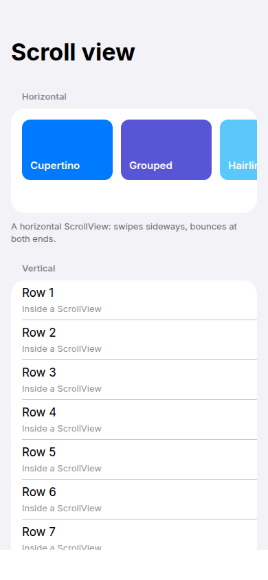
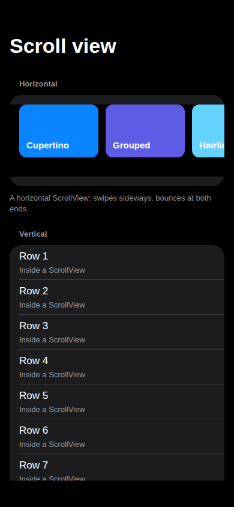

# 滚动视图

带 iOS 行为的原生滚动视图：内容在两端回弹、使用平台的滚动条、键盘随拖动收起。

| | |
| --- | --- |
| 浅色 |  |
| 深色 |  |

| TSX | Rust | 类型 | 默认值 | |
| --- | --- | --- | --- | --- |
| `children` | `.child(..)` | JSX | — | 内容 |
| `horizontal` | `.horizontal(..)` | `boolean` | `false` | 横向滚动 |
| `bounces` | `.bounces(..)` | `boolean` | `true` | 越界并弹回 |
| `indicator` | `.indicator(..)` | `boolean` | `true` | 平台的滚动条 |
| `keyboardDismiss` | `.keyboard_dismiss(..)` | `"none"` \| `"on-drag"` \| `"interactive"` | `interactive` | 拖动是否收起键盘 |

说明

- 给它一个有界高度（页面里用 `flex: 1`）；没有边界的滚动视图会随内容撑开，永远不滚。
- 内容按滚动视图的宽度布局，高度按需；内边距与间距写在一个子视图上，不要写在滚动视图上。
- 长列表或数量不定时用 `List`（TSX/Rust 里的 `virtual_list`），它会复用行；滚动视图会创建
  每一个子元素。

## 无障碍

- 读屏滚动的是平台的滚动视图；内容保持自己的顺序。

## 动效

回弹由平台决定；滚动条按平台的方式淡出。
