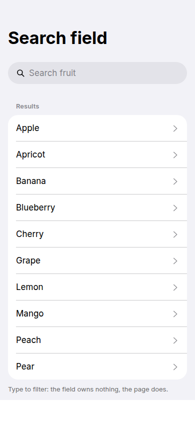
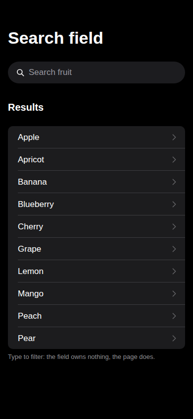

# Search field

iOS's search field: 36 pt tall, 9 pt corners, a magnifier before the text, a
clear button, and an optional Cancel beside it.

| | |
| --- | --- |
| Light |  |
| Dark |  |

| TSX | Rust | Type | Default | |
| --- | --- | --- | --- | --- |
| `value` | `.value(..)` | `string` | `""` | The text; the app owns it |
| `placeholder` | `.placeholder(..)` | `string` | `"Search"` | Shown while empty |
| `label` | `.label(..)` | `string` | none | What screen readers call the field |
| `cancel` | `.cancel(..)` | `boolean` | `false` | A Cancel button while the field is focused |
| `children` | `.child(..)` | JSX | none | A row under the field (scopes arrive in wave B) |

Events: `onChange(text)`, `onSubmit(text)`, `onCancel`.

Notes

- The field is on `tertiaryFill` with the placeholder in `placeholderText`, as a
  search bar has it; the role is search.
- Cancel reports `onCancel`; the app usually clears its query there.

## Accessibility

- Role search, named by its placeholder or `label`.
- The clear button is named "Clear search"; Cancel is a button named "Cancel".

## Motion

The Cancel button appears with the field's focus; nothing else animates.
