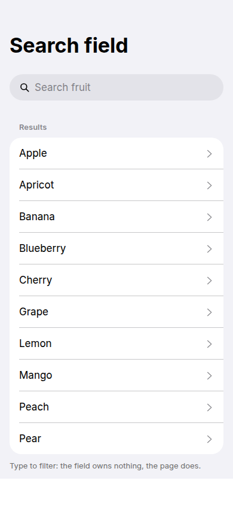
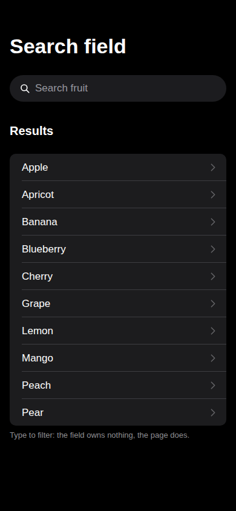

# 搜索框

iOS 的搜索框：36 pt 高、9 pt 圆角，文本前有放大镜，有清除按钮，旁边可选"取消"。

| | |
| --- | --- |
| 浅色 |  |
| 深色 |  |

| TSX | Rust | 类型 | 默认值 | |
| --- | --- | --- | --- | --- |
| `value` | `.value(..)` | `string` | `""` | 文本；由应用持有 |
| `placeholder` | `.placeholder(..)` | `string` | `"Search"` | 为空时显示 |
| `label` | `.label(..)` | `string` | 无 | 读屏名称 |
| `cancel` | `.cancel(..)` | `boolean` | `false` | 聚焦时显示"取消" |
| `children` | `.child(..)` | JSX | 无 | 框下方的一行（范围切换属于 wave B） |

事件：`onChange(text)`、`onSubmit(text)`、`onCancel`。

说明

- 背景是 `tertiaryFill`，placeholder 用 `placeholderText`，与搜索栏一致；角色是 search。
- "取消"通过 `onCancel` 报告；应用通常在这里清空查询。

## 无障碍

- 角色为 search，名称为 placeholder 或 `label`。
- 清除按钮名称是 "Clear search"；"取消"是名称为 "Cancel" 的按钮。

## 动效

"取消"随输入框聚焦出现；其它没有动画。
