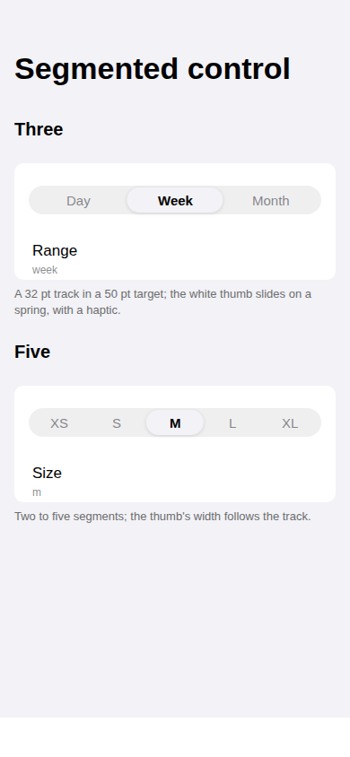
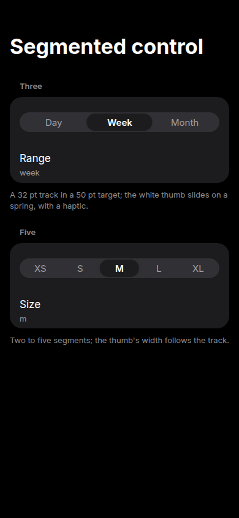

[简体中文](segmented-control.zh-CN.md)

# Segmented control

A track of two to five segments with a white thumb that slides to the chosen
one, over the design system's spring, with a haptic tick.

| | |
| --- | --- |
| Light |  |
| Dark |  |

| TSX | Rust | Type | Default | |
| --- | --- | --- | --- | --- |
| `items` | `.items(..)` | `SegmentItem[]` | `[]` | Two to five, in order |
| `value` | `.value(..)` | `string` | first | Chosen value, controlled |
| `defaultValue` | `.default_value(..)` | `string` | first | At first |
| `label` | `.label(..)` | `string` | `"Segments"` | The group's name |

`SegmentItem`: `{ value, title }`.

Events: `onChange(value, index)`.

Notes

- The track is a 32 pt capsule inside a 50 pt target, as iOS draws it; the thumb is
  `secondarySystemBackground` with a soft shadow.
- The thumb's width and position follow the measured track, so it fits any
  width and any number of segments from two to five.
- The chosen title is semibold and label-colored; the others are regular and
  secondary.

## Accessibility

- The control is a tab list; each segment is a button, selected when chosen, and
  named by its title. Tab reaches them, Return or Space activates one.

## Motion

The thumb slides on a 0.9-damping spring; the color and weight change over the
same motion. Reduce Motion jumps it.
