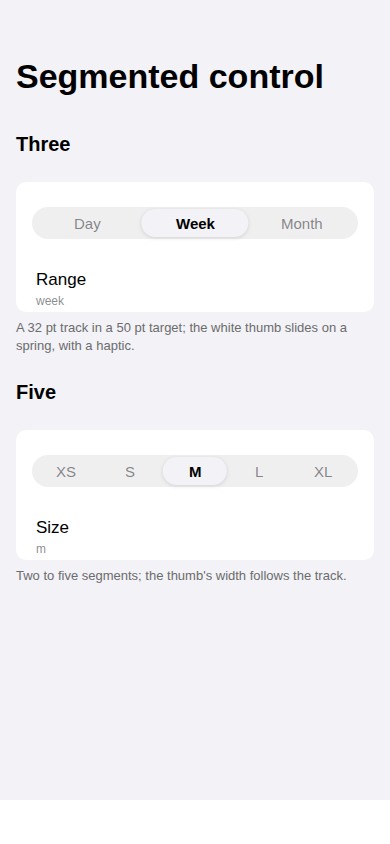
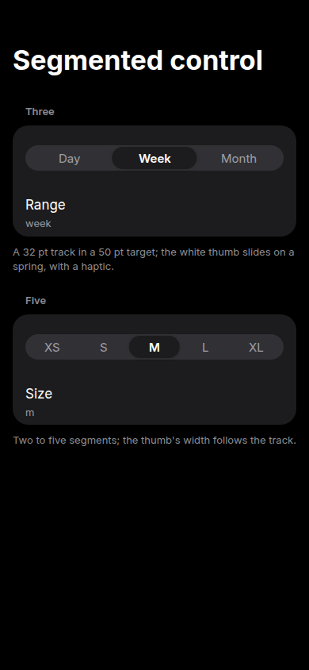

[English](segmented-control.md)

# 分段控件 Segmented control

2 到 5 个分段，白色滑块以设计系统的弹簧滑到选中项，并有一次触感反馈。

| | |
| --- | --- |
| 浅色 |  |
| 深色 |  |

| TSX | Rust | 类型 | 默认 | |
| --- | --- | --- | --- | --- |
| `items` | `.items(..)` | `SegmentItem[]` | `[]` | 2 到 5 个，按顺序 |
| `value` | `.value(..)` | `string` | 第一项 | 受控选中值 |
| `defaultValue` | `.default_value(..)` | `string` | 第一项 | 初始值 |
| `label` | `.label(..)` | `string` | `"Segments"` | 组名称 |

`SegmentItem`：`{ value, title }`。

事件：`onChange(value, index)`。

说明

- 轨道是高 32 pt 的胶囊，放在 50 pt 的触控区域内，与 iOS 一致；滑块为 `secondarySystemBackground` 加柔和阴影。
- 滑块宽度与位置按实测轨道计算，适合任意宽度和 2–5 个分段。
- 选中项为半粗、label 色；其余为常规、次要色。

## 无障碍

- 控件是 tab list；每个分段是按钮，选中时带 selected 状态，以标题为名称。Tab 可达，Return/Space 激活。

## 动效

滑块使用阻尼 0.9 的弹簧；颜色与字重同步变化。减弱动态效果时直接跳转。
