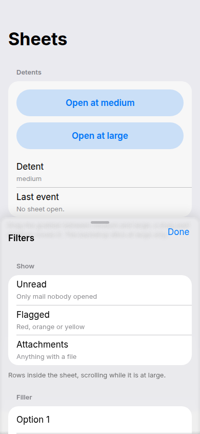
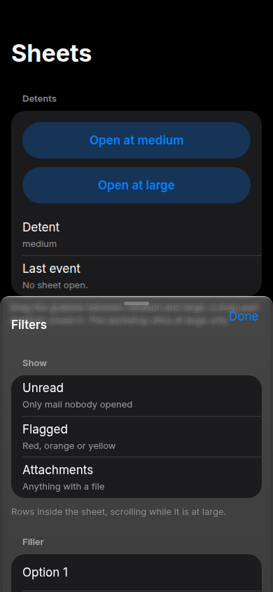

[简体中文](sheet.zh-CN.md)

# Sheet

A panel from the bottom with iOS's two detents: **medium** at half the screen and
**large** just below the status bar. Drag the grabber (or the header) between
them; a drag past medium closes it.

| | |
| --- | --- |
| Light |  |
| Dark |  |

| TSX | Rust | Type | Default | |
| --- | --- | --- | --- | --- |
| `open` | `.open(..)` | `boolean` | — | Controlled; follow `onOpenChange` |
| `defaultOpen` | `.default_open(..)` | `boolean` | `false` | Open at first, uncontrolled |
| `detent` | `.detent(..)` | `"medium" \| "large"` | none | Controlled detent |
| `defaultDetent` | `.default_detent(..)` | `"medium" \| "large"` | `"large"` | Detent at first |
| `title` | `.title(..)` | `string` | none | 17 pt semibold in the header |
| `leading` | `.leading(..)` | `string` | none | "Cancel", in the tint |
| `trailing` | `.trailing(..)` | `string` | none | "Done", in the tint |
| `children` | `.child(..)` | JSX | — | The content, which scrolls |

Events: `onOpenChange(open)`, `onDetentChange(detent)`, `onCancel()`, `onLeading()`,
`onTrailing()`.

Notes

- The panel is the `thick` material (`tokens::materials`): its fill over a
  30 pt blur, so the page shows through faintly as it does on iOS.
- One large panel is moved by an animated offset, so the drag, the finger's
  release velocity and the springs between detents run on the UI thread.
- The backdrop dims only at large (0.32) and hardly at medium (0.03), as iOS.
- Escape, the Android back button, a press on the backdrop and a drag past
  medium close it; `Done` reports the trailing action and asks to close, and
  `Cancel` reports the leading one the same way.
- Give the app's `detent` and follow `onDetentChange` when the app owns it; a
  drag that changes detents also reports it.

## Accessibility

- The panel is a dialog; the grabber's header is a group. The title is read once.
- Escape and back close it; Return presses the trailing action.

## Motion

The entrance is the design system's sheet spring (0.8 damping, 400 stiffness);
between detents the release velocity feeds the spring. Reduce Motion removes the
entrance and exit.
