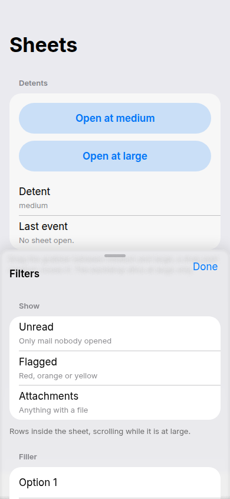
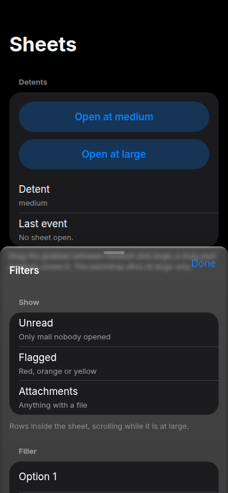

[English](sheet.md)

# 面板 Sheet

从底部升起的面板，两个高度档位：**中档**为半屏，**大档**停在状态栏下方 10 pt。拖动顶部把手（或标题栏）在两档之间移动，拖过中档即关闭。

| | |
| --- | --- |
| 浅色 |  |
| 深色 |  |

| TSX | Rust | 类型 | 默认 | |
| --- | --- | --- | --- | --- |
| `open` | `.open(..)` | `boolean` | — | 受控；跟随 `onOpenChange` |
| `defaultOpen` | `.default_open(..)` | `boolean` | `false` | 非受控时初始打开 |
| `detent` | `.detent(..)` | `"medium" \| "large"` | 无 | 受控档位 |
| `defaultDetent` | `.default_detent(..)` | `"medium" \| "large"` | `"large"` | 初始档位 |
| `title` | `.title(..)` | `string` | 无 | 标题栏 17 pt 半粗 |
| `leading` | `.leading(..)` | `string` | 无 | 左侧操作（"取消"），使用 tint 色 |
| `trailing` | `.trailing(..)` | `string` | 无 | 右侧操作（"完成"），使用 tint 色 |
| `children` | `.child(..)` | JSX | — | 面板内容，可滚动 |

事件：`onOpenChange(open)`、`onDetentChange(detent)`、`onCancel()`、`onTrailing()`。

说明

- 面板使用 `thick` 材质（`tokens::materials`）：填充叠加 30 pt 模糊，页面会像 iOS 一样隐约透出。
- 面板是一个大档高度，用动画位移表示档位与手指拖动，拖动、释放速度和档位间的弹簧都在 UI 线程运行。
- 遮罩只在大档时明显变暗（0.32），中档几乎不暗（0.03），与 iOS 一致。
- Escape、Android 返回、点击遮罩和拖过中档都会关闭；"完成"会上报 `onTrailing` 并请求关闭。
- 应用若自己持有 `detent`，要跟随 `onDetentChange`。
- 面板最宽 640 pt（`metrics::SHEET_MAX_WIDTH`）。窗口比这更宽时，面板居中成一张四角圆角、距底边 16 pt 的卡片，与 iPad 的表单面板一致；手机上则为全屏宽。

## 无障碍

- 面板是 dialog，把手所在标题栏是 group，标题只读一次。
- Escape 与返回可关闭；Return 触发右侧操作。

## 动效

进场使用设计系统的面板弹簧（临界阻尼 1.0、刚度 280），按 iOS 的 sheet 录屏拟合；档位间使用释放速度驱动同一弹簧。开启"减弱动态效果"时去掉进出场。

在 iOS 上，Cohub Mobile 使用原生 SwiftUI 面板（`AdaptiveSheet.ios.tsx:2`），其 Reanimated 面板弹簧（`motion.ts:36-47`）只在非 iOS 分支运行。不要把本库的弹簧对齐到 Cohub 的数值：它是按 iOS 录屏拟合的。
