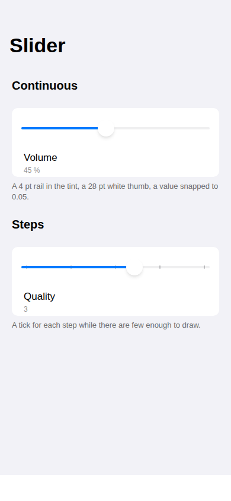
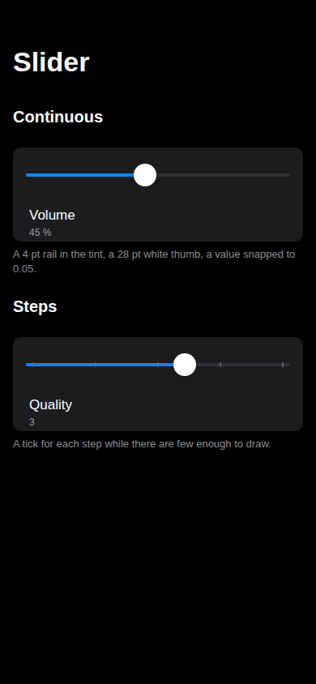

[简体中文](slider.zh-CN.md)

# Slider

A 4 pt rail in the tint, a white 28 pt thumb with a soft shadow, and a tick for
each step while there are few enough to draw.

| | |
| --- | --- |
| Light |  |
| Dark |  |

| TSX | Rust | Type | Default | |
| --- | --- | --- | --- | --- |
| `value` | `.value(..)` | `number` | — | Controlled |
| `defaultValue` | `.default_value(..)` | `number` | `min` | At first |
| `min` | `.min(..)` | `number` | `0` | The smallest |
| `max` | `.max(..)` | `number` | `1` | The largest |
| `step` | `.step(..)` | `number` | `0.05` | The step values snap to; `0` for any |
| `disabled` | `.disabled(..)` | `boolean` | `false` | Dimmed, not draggable |
| `label` | `.label(..)` | `string` | `"Slider"` | What screen readers call it |

Events: `onChange(value)`, `onChangeEnd(value)`.

Notes

- Behavior is `nsh/base`'s `Slider`: dragging anywhere on the track moves the
  thumb, keys move it by a step (arrows, Page Up/Down, Home, End), and screen
  readers can set it.
- Ticks are drawn at every step when there are 2 to 12 steps; they are
  `quaternaryLabel` dots over the rail.
- The thumb and its shadow are the design system's; the turn snap uses `step`.

## Accessibility

- Role slider (adjustable) with its name and value; `disabled` is announced.
- The keyboard and a screen reader's increment both report `onChange`.

## Motion

The thumb follows the finger directly; a keyboard step nudges it and the rail
follows. No animation is added, so nothing needs a reduced-motion path.
