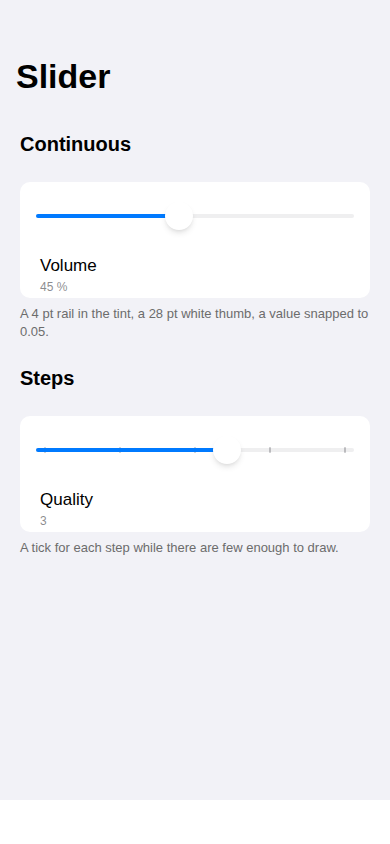
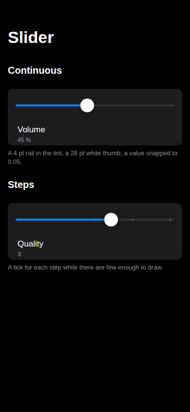

[English](slider.md)

# 滑块 Slider

4 pt 的 tint 轨道、28 pt 白色滑块（带柔和阴影），步数足够少时每一步画一个刻度。

| | |
| --- | --- |
| 浅色 |  |
| 深色 |  |

| TSX | Rust | 类型 | 默认 | |
| --- | --- | --- | --- | --- |
| `value` | `.value(..)` | `number` | — | 受控 |
| `defaultValue` | `.default_value(..)` | `number` | `min` | 初始值 |
| `min` | `.min(..)` | `number` | `0` | 最小值 |
| `max` | `.max(..)` | `number` | `1` | 最大值 |
| `step` | `.step(..)` | `number` | `0.05` | 吸附步长；`0` 为任意值 |
| `disabled` | `.disabled(..)` | `boolean` | `false` | 变淡且不可拖动 |
| `label` | `.label(..)` | `string` | `"Slider"` | 无障碍名称 |

事件：`onChange(value)`、`onChangeEnd(value)`。

说明

- 行为来自 `nsh/base` 的 `Slider`：在轨道任意位置拖动都会移动滑块，方向键、Page Up/Down、Home/End 按键调整，读屏也可设置。
- 步数在 2 到 12 之间时每一步画一个 `quaternaryLabel` 圆点。
- 滑块与阴影由设计系统提供，取值按 `step` 对齐。

## 无障碍

- 角色为 slider（adjustable），带名称和值；禁用状态会被读出。
- 键盘与读屏的增减都上报 `onChange`。

## 动效

滑块直接跟随手指；键盘步进立即生效，不额外加动画，因此无需单独处理减弱动态效果。
