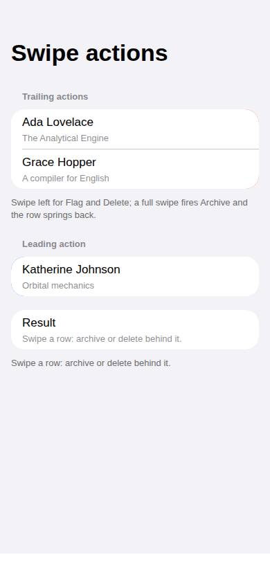
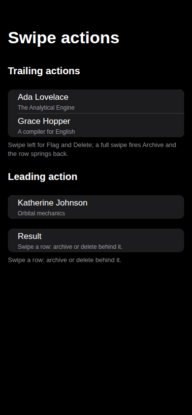

[简体中文](swipe-actions.zh-CN.md)

# Swipe actions

Actions behind a list row, as Mail has them: swipe right for the leading ones,
left for the trailing ones, and a full swipe for the row's main action.

| | |
| --- | --- |
| Light |  |
| Dark |  |

| TSX | Rust | Type | Default | |
| --- | --- | --- | --- | --- |
| `children` | `.child(..)` | JSX | — | The row, usually a `ListTile` |
| `leading` | `.leading(..)` | `SwipeAction[]` | `[]` | Revealed by swiping right |
| `trailing` | `.trailing(..)` | `SwipeAction[]` | `[]` | Revealed by swiping left |
| `fullSwipe` | `.full_swipe(..)` | `string` | none | The action id a full swipe fires |

`SwipeAction`: `{ id, title, icon?, tint?, destructive? }`.

Events: `onAction(id, full)`.

Notes

- The row moves with its finger through a bound animated value; because only the
  horizontal axis is bound, a vertical drag still scrolls the list. Releasing
  past half an action's width snaps the row open; past two thirds of the row a
  full swipe fires `fullSwipe` and springs back, so the app can show an undo
  bar.
- Actions are 80 pt wide, white icon and 12 pt label, red for destructive, or
  the `tint` token.
- Keep the row's own hairline: put the `SwipeRow` around a `ListTile` with
  `separator` as usual.

## Accessibility

- Each action is a button named by its title, so screen readers and the keyboard
  can reach it even when the row is closed (the actions sit behind it).
- A full swipe is a convenience; every action is also a button.

## Motion

Snapping uses the design system's spring; a full swipe springs out and back over
220 ms. Reduce Motion still snaps, as the platform's scroll does.
