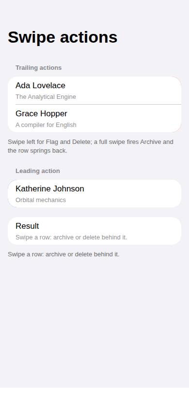
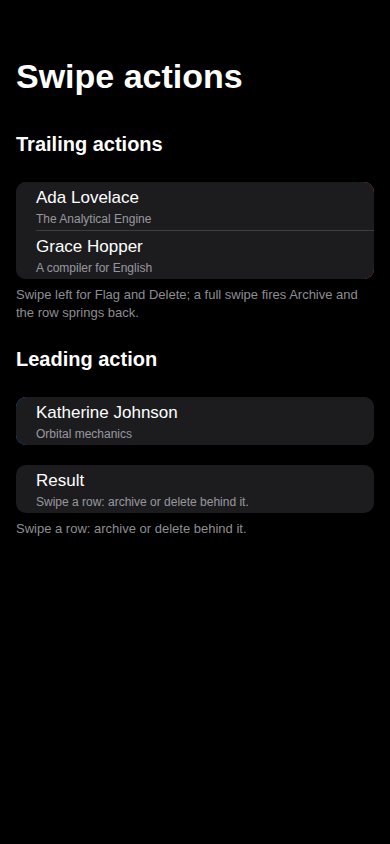

[English](swipe-actions.md)

# 滑动操作 Swipe actions

列表行背后的操作，像邮件：右滑显示前导操作，左滑显示尾随操作，整行滑到底触发主操作。

| | |
| --- | --- |
| 浅色 |  |
| 深色 |  |

| TSX | Rust | 类型 | 默认 | |
| --- | --- | --- | --- | --- |
| `children` | `.child(..)` | JSX | — | 行内容，通常是 `ListTile` |
| `leading` | `.leading(..)` | `SwipeAction[]` | `[]` | 右滑显示 |
| `trailing` | `.trailing(..)` | `SwipeAction[]` | `[]` | 左滑显示 |
| `fullSwipe` | `.full_swipe(..)` | `string` | 无 | 整滑触发的操作 id |

`SwipeAction`：`{ id, title, icon?, tint?, destructive? }`。

事件：`onAction(id, full)`。

说明

- 行通过绑定的动画值跟随手指；因为只绑定水平轴，纵向拖动仍然滚动列表。超过半个操作宽度释放会吸附打开；超过行宽三分之二触发整滑并弹回，应用可以据此显示撤销条。
- 操作宽 80 pt，白色图标和 12 pt 文字，破坏性为红色，或使用 `tint` token。
- 保留行自己的分隔线：把 `SwipeRow` 包在带 `separator` 的 `ListTile` 外。

## 无障碍

- 每个操作都是按钮并以标题命名，即使行关闭时读屏和键盘也能到达（操作位于行后方）。
- 整滑只是快捷方式；每个操作也都有按钮。

## 动效

吸附使用设计系统的弹簧；整滑在 220 ms 内弹出再弹回。减弱动态效果时仍会吸附，与平台滚动一致。
