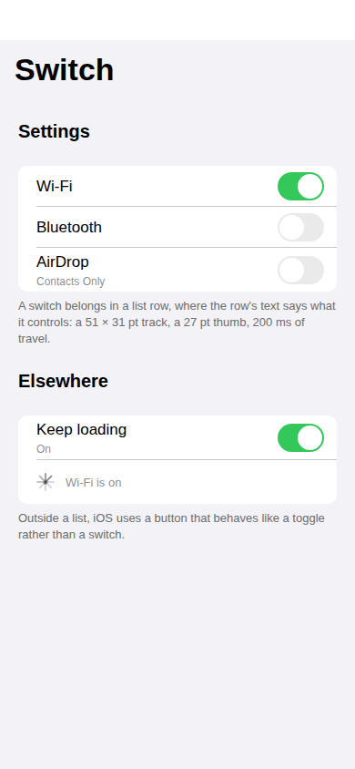
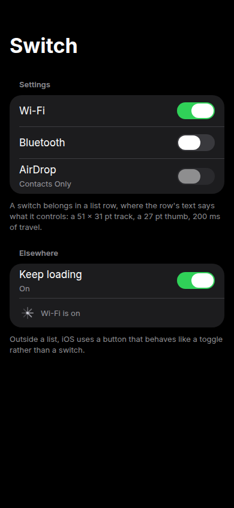

[简体中文](switch.zh-CN.md)

# Switch

iOS's on / off switch: a 51 × 31 pt pill, `systemGreen` when on, `secondaryFill`
when off, with a 27 pt white thumb that travels 20 pt over 200 ms.

| | |
| --- | --- |
| Light |  |
| Dark |  |

| TSX | Rust | Type | Default | |
| --- | --- | --- | --- | --- |
| `checked` | `.checked(..)` | `boolean` | `false` | On or off; the app owns it |
| `disabled` | `.disabled(..)` | `boolean` | `false` | Dimmed, not pressable |
| `label` | `.label(..)` | `string` | none | What screen readers say |

Events: `onChange(checked)`.

Notes

- Behavior comes from `nsh/base`'s `Switch`: role switch, its state read, Space
  and Return press it, and 8 pt of hit slop around the small track.
- The track has a soft shadow under the thumb and transitions its color; the thumb
  travels with a transform, so the motion runs on the UI thread.

## Accessibility

- Role switch with `checked`; the label is either `label` or the text beside it.
- Disabled switches are announced as dimmed and report no presses.

## Motion

200 ms on the thumb's travel and the track's color. Reduced motion is honoured by
the platform's animator.
