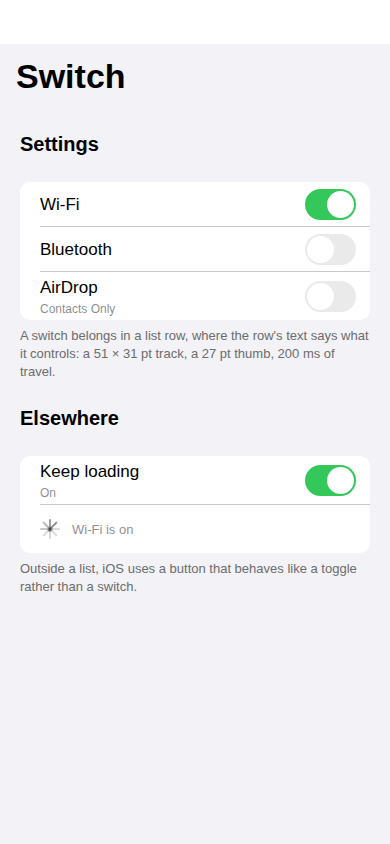
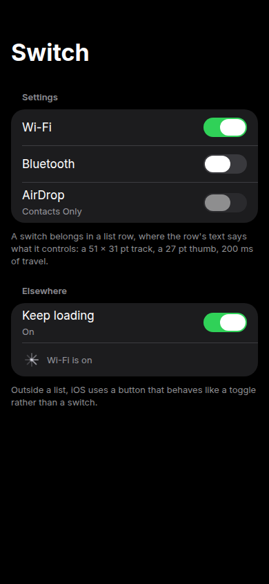

[English](switch.md)

# 开关

iOS 的开关：51 × 31 pt 胶囊，开启为 `systemGreen`，关闭为 `secondaryFill`，27 pt 白色滑块
在 200 ms 内移动 20 pt。

| | |
| --- | --- |
| 浅色 |  |
| 深色 |  |

| TSX | Rust | 类型 | 默认值 | |
| --- | --- | --- | --- | --- |
| `checked` | `.checked(..)` | `boolean` | `false` | 开或关；由应用持有 |
| `disabled` | `.disabled(..)` | `boolean` | `false` | 变灰，不可按下 |
| `label` | `.label(..)` | `string` | 无 | 读屏名称 |

事件：`onChange(checked)`。

说明

- 行为来自 `nsh/base` 的 `Switch`：角色是 switch，读屏可读状态，空格与回车可以按下，
  小轨道周围有 8 pt 的额外命中范围。
- 轨道有滑块下方的柔和阴影并过渡颜色；滑块用 transform 移动，所以动画在 UI 线程上运行。

## 无障碍

- 角色为 switch，带 `checked`；名称来自 `label` 或旁边的文字。
- 禁用开关读作"变灰"，且不报告按压。

## 动效

滑块移动与轨道变色各 200 ms。"减少动态效果"由平台的动画器处理。
