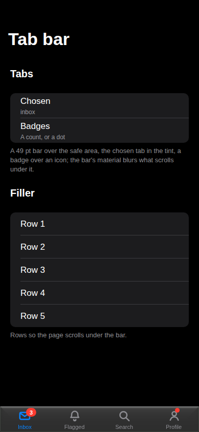

[简体中文](tab-bar.zh-CN.md)

# Tab bar

A 49 pt bar over the safe area, one tab per destination: a 25 pt icon, a 10 pt
label, the chosen one in the tint, and an optional badge over its icon.

| | |
| --- | --- |
| Light |  |
| Dark |  |

| TSX | Rust | Type | Default | |
| --- | --- | --- | --- | --- |
| `items` | `.items(..)` | `TabItem[]` | `[]` | The tabs, in order |
| `value` | `.value(..)` | `string` | first | Chosen value, controlled |
| `defaultValue` | `.default_value(..)` | `string` | first | At first |
| `blur` | `.blur(..)` | `boolean` | `true` | The material behind it |
| `label` | `.label(..)` | `string` | `"Tabs"` | The bar's name |

`TabItem`: `{ value, title, icon?, badge? }`; `badge` is text ("3", "99+") or
`"dot"`.

Events: `onChange(value, index)`.

Notes

- The bar is a material: the `regular` material: its translucent fill over a 25 pt backdrop blur,
  with a one-device-pixel hairline on top. The page can scroll under it.
- Linux and GPUI draw no backdrop blur; there the material's translucent fill alone keeps
  the bar readable — the same fallback iOS uses with Reduce Transparency.
- Unchosen tabs are `systemGray`; the chosen one is `systemBlue`. Badges are
  red, 17 pt tall pills, and a dot is 9 pt.

## Accessibility

- The bar is a tab list and each tab a button, selected when chosen, named by
  its label; Tab reaches them, Return or Space activates one.
- A badge's count is part of the tab's name.

## Motion

The selection color changes over 150 ms; no layout moves. Reduce Motion needs
no separate path.

## Glass bar

`GlassTabBar` is iOS 26's tab bar: an inset capsule of glass floating over the
content, not an edge-to-edge band.

```tsx
<GlassTabBar
  items={tabs}
  value={tab()}
  scrollOffset={offset()}
  behavior="on-scroll-down"
  onChange={(event) => tab.set(event.value)}
/>
```

| Prop | Type | Default | |
| --- | --- | --- | --- |
| `items` | `TabItem[]` | | Value, title, icon and badge per tab. |
| `value` / `defaultValue` | string | | The chosen tab (controlled) or its first value. |
| `behavior` | `"on-scroll-down" \| "on-scroll-up" \| "never"` | `"on-scroll-down"` | UIKit's `MinimizeBehavior`: minimise on the way down and expand on the way up. |
| `scrollOffset` | number | | The page's offset, fed from its `onScroll`; without it the bar never minimises. |
| `minimized` | boolean | | Forces the state while set. |
| `material` | `"glass" \| "material"` | `"glass"` | The shader, or the blur-only fill (for comparing the two). |
| `onChange` | `{ value, index }` | | Another tab was chosen. |

Shape and motion: 64 pt tall, radius 32, 20 pt from the sides and 12 pt above the
home indicator, 27.5 pt icons and 10 pt labels. The chosen tab has a capsule of
its own. A downward scroll of 20 pt minimises the bar into a 50 pt pill around
that tab, an upward scroll of 12 pt expands it, the top of the page always
expands it, content shorter than 40 pt never minimises, and the spring is
damping 0.78 / stiffness 340. Place it in the page's root view (it positions
itself) and leave room at the bottom of the content.

The edge-to-edge `TabBar` above stays for pages that want a bar flush with the
screen's bottom.
