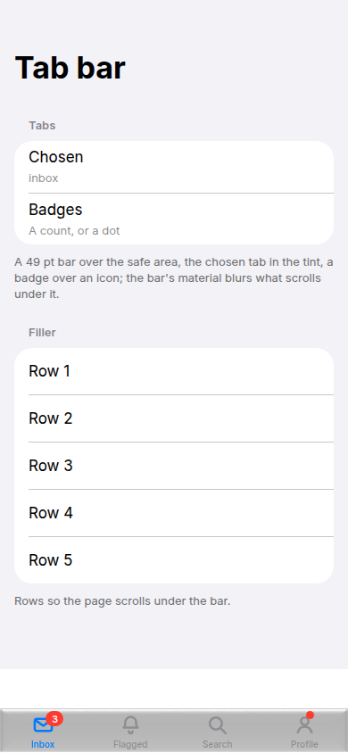

[简体中文](tab-bar.zh-CN.md)

# Tab bar

A 49 pt bar over the safe area, one tab per destination: a 25 pt icon, a 10 pt
label, the chosen one in the tint, and an optional badge over its icon.

| | |
| --- | --- |
| Light |  |
| Dark |  |

| TSX | Rust | Type | Default | |
| --- | --- | --- | --- | --- |
| `items` | `.items(..)` | `TabItem[]` | `[]` | The tabs, in order |
| `value` | `.value(..)` | `string` | first | Chosen value, controlled |
| `defaultValue` | `.default_value(..)` | `string` | first | At first |
| `blur` | `.blur(..)` | `boolean` | `true` | The material behind it |
| `label` | `.label(..)` | `string` | `"Tabs"` | The bar's name |

`TabItem`: `{ value, title, icon?, badge? }`; `badge` is text ("3", "99+") or
`"dot"`.

Events: `onChange(value, index)`.

Notes

- The bar is a material: the `regular` material: its translucent fill over a 25 pt backdrop blur,
  with a one-device-pixel hairline on top. The page can scroll under it.
- Linux and GPUI draw no backdrop blur; there the material's translucent fill alone keeps
  the bar readable — the same fallback iOS uses with Reduce Transparency.
- Unchosen tabs are `systemGray`; the chosen one is `systemBlue`. Badges are
  red, 17 pt tall pills, and a dot is 9 pt.

## Accessibility

- The bar is a tab list and each tab a button, selected when chosen, named by
  its label; Tab reaches them, Return or Space activates one.
- A badge's count is part of the tab's name.

## Motion

The selection color changes over 150 ms; no layout moves. Reduce Motion needs
no separate path.
