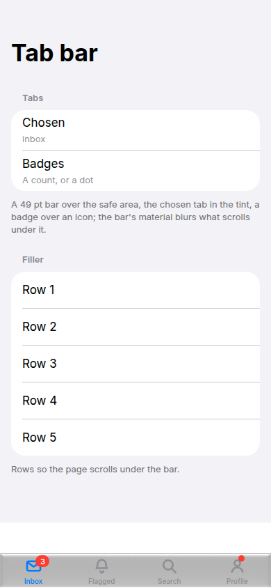
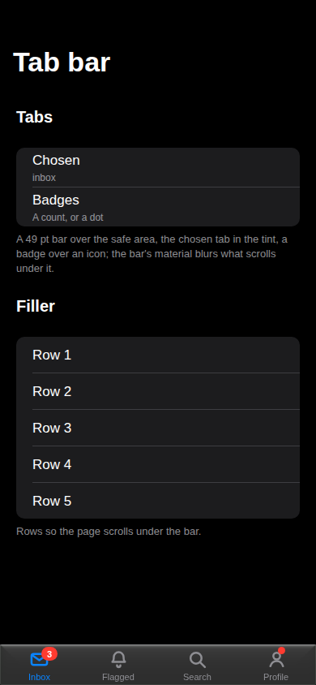

[English](tab-bar.md)

# 标签栏 Tab bar

安全区上方的 49 pt 栏，每个目标一个标签：25 pt 图标、10 pt 文字，选中项使用 tint 色，图标右上角可有徽标。

| | |
| --- | --- |
| 浅色 |  |
| 深色 |  |

| TSX | Rust | 类型 | 默认 | |
| --- | --- | --- | --- | --- |
| `items` | `.items(..)` | `TabItem[]` | `[]` | 标签，按顺序 |
| `value` | `.value(..)` | `string` | 第一项 | 受控选中值 |
| `defaultValue` | `.default_value(..)` | `string` | 第一项 | 初始值 |
| `blur` | `.blur(..)` | `boolean` | `true` | 背后的材质 |
| `label` | `.label(..)` | `string` | `"Tabs"` | 栏名称 |

`TabItem`：`{ value, title, icon?, badge? }`；`badge` 为文字（"3"、"99+"）或 `"dot"`。

事件：`onChange(value, index)`。

说明

- 栏是材质：`regular` 材质：半透明填充覆盖在 25 pt 背景模糊上，顶部一条一设备像素分隔线。页面内容可以从它下面滚过。
- Linux 与 GPUI 没有背景模糊，材质的半透明填充仍能保证可读——这与 iOS 开启"降低透明度"时的回退一致。
- 未选中为 `systemGray`，选中为 `systemBlue`。徽标是红色 17 pt 胶囊，圆点为 9 pt。

## 无障碍

- 栏是 tab list，每个标签是按钮，选中时带 selected 状态并以文字为名称；Tab 可达，Return/Space 激活。
- 徽标数字属于标签名称的一部分。

## 动效

选中颜色在 150 ms 内过渡，无布局移动。减弱动态效果无需单独处理。
