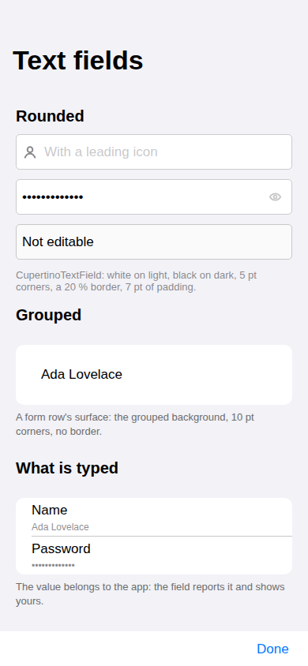
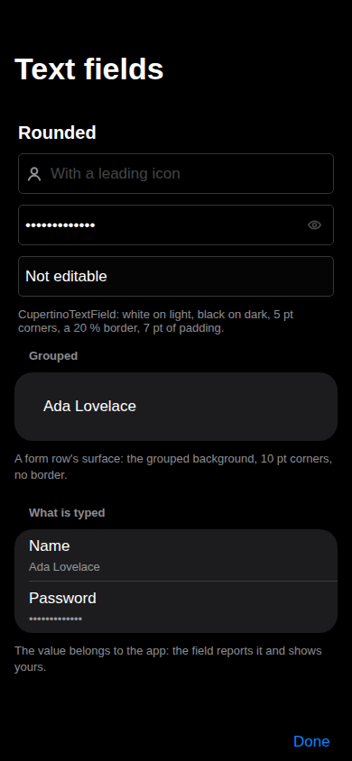

# Text field

A rounded grouped field, as a `Form` row has it: `secondarySystemGroupedBackground`,
10 pt corners, 44 pt tall, a caret and selection in the tint color, iOS's clear
and reveal buttons.

| | |
| --- | --- |
| Light |  |
| Dark |  |

| TSX | Rust | Type | Default | |
| --- | --- | --- | --- | --- |
| `value` | `.value(..)` | `string` | `""` | The text; the app owns it |
| `placeholder` | `.placeholder(..)` | `string` | none | Shown while empty |
| `secure` | `.secure(..)` | `boolean` | `false` | Hides the text, with an eye button |
| `clear` | `.clear(..)` | `boolean` | `true` | A clear button while focused and non-empty |
| `leading` | `.leading(..)` | icon name | none | An icon before the text |
| `label` | `.label(..)` | `string` | none | What screen readers call the field |
| `keyboard` | `.keyboard(..)` | `"default"` \| `"email"` \| `"number"` \| `"phone"` \| `"url"` | `default` | The software keyboard |
| `returnKey` | `.return_key(..)` | `"done"` \| `"go"` \| `"next"` \| `"search"` \| `"send"` | `default` | The return key's label |
| `disabled` | `.disabled(..)` | `boolean` | `false` | Read-only and dimmed |

Events: `onChange(text)`, `onSubmit(text)`.

Notes

- The value is the app's: the field reports every change and shows what it is
  given. The clear button therefore clears by reporting `""` — set the value from
  `onChange`, or nothing happens.
- Clearing keeps the focus (and the keyboard) where it was.
- The focused field keeps its caret; a keyboard-driven focus (Tab) adds a 2 pt
  tint ring, so the iOS look is unchanged on touches.

## Accessibility

- The field is a text field with its placeholder or `label` as its name.
- The clear button is named "Clear text", the reveal button "Show text" / "Hide
  text"; both are 28 pt targets in the row's trailing edge.

## Motion

Nothing animates but the caret and the selection; the reveal and clear buttons
fade to 40 % while pressed.
