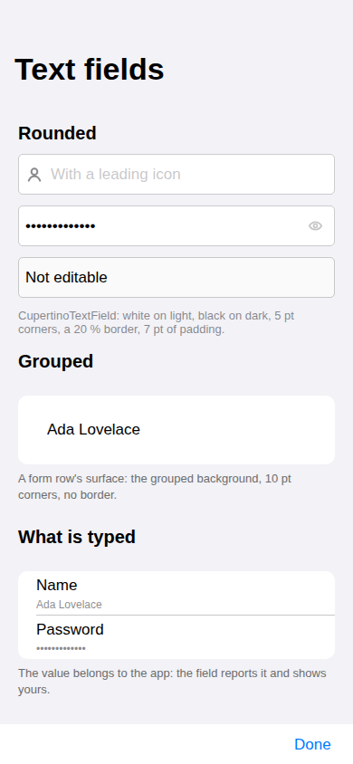
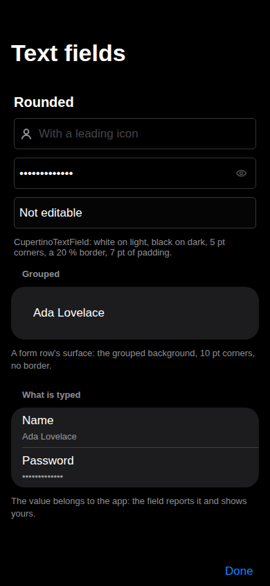

# 输入框

圆角分组输入框，像 `Form` 里的一行：`secondarySystemGroupedBackground` 背景、10 pt 圆角、
44 pt 高，光标与选区使用着色，带 iOS 的清除与显示按钮。

| | |
| --- | --- |
| 浅色 |  |
| 深色 |  |

| TSX | Rust | 类型 | 默认值 | |
| --- | --- | --- | --- | --- |
| `value` | `.value(..)` | `string` | `""` | 文本；由应用持有 |
| `placeholder` | `.placeholder(..)` | `string` | 无 | 为空时显示 |
| `secure` | `.secure(..)` | `boolean` | `false` | 隐藏文本，并带眼睛按钮 |
| `clear` | `.clear(..)` | `boolean` | `true` | 聚焦且非空时显示清除按钮 |
| `leading` | `.leading(..)` | 图标名 | 无 | 文本前的图标 |
| `label` | `.label(..)` | `string` | 无 | 读屏名称 |
| `keyboard` | `.keyboard(..)` | `"default"` \| `"email"` \| `"number"` \| `"phone"` \| `"url"` | `default` | 软键盘类型 |
| `returnKey` | `.return_key(..)` | `"done"` \| `"go"` \| `"next"` \| `"search"` \| `"send"` | `default` | 回车键文案 |
| `disabled` | `.disabled(..)` | `boolean` | `false` | 只读并变灰 |

事件：`onChange(text)`、`onSubmit(text)`。

说明

- 值归应用所有：输入框报告每次变化，并显示你给它的值。所以清除按钮通过报告 `""` 来清空——
  请在 `onChange` 里更新值，否则什么也不会发生。
- 清除后焦点（与键盘）留在原处。
- 聚焦的输入框保留光标；键盘焦点（Tab）会额外显示 2 pt 着色环，所以触摸时的 iOS 外观不变。

## 无障碍

- 输入框是文本输入，名称为 placeholder 或 `label`。
- 清除按钮名称是 "Clear text"，显示按钮是 "Show text" / "Hide text"；两者都是 28 pt 目标，
  位于行尾。

## 动效

除光标与选区外没有动画；显示与清除按钮按下时淡到 40 %。
