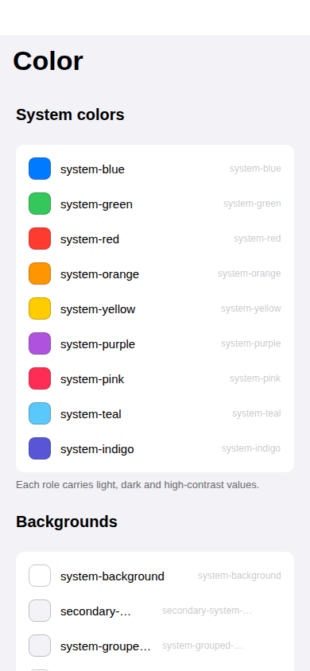
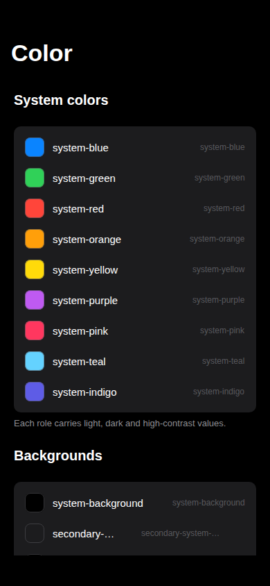
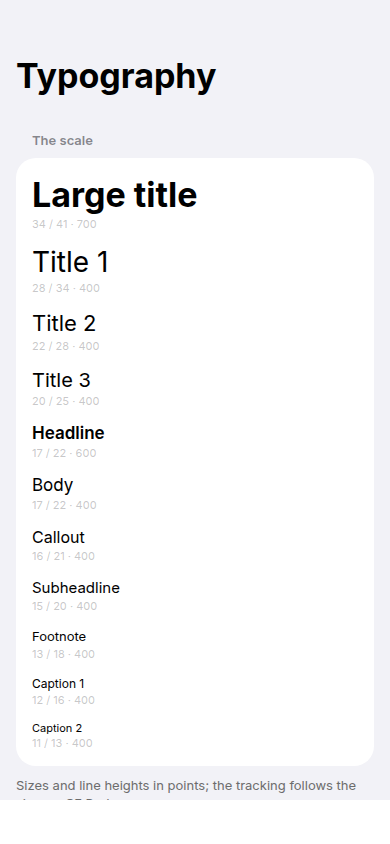

[简体中文](theme.zh-CN.md)

# Theme and tokens

`Theme` installs the Cupertino tokens for the app and switches to the
high-contrast values when the app asks for them. `tokens` is the data behind it.

| | |
| --- | --- |
| Light |  |
| Dark |  |
| Typography |  |

| TSX | Rust | Type | Default | |
| --- | --- | --- | --- | --- |
| `contrast` | `.contrast(..)` | `"normal"` \| `"high"` | `normal` | The contrast set |
| `children` | `.child(..)` | JSX | — | The app |

## Tokens

| Group | Names |
| --- | --- |
| Backgrounds | `system-background`, `secondary-system-background`, `tertiary-system-background` |
| Grouped | `system-grouped-background`, `secondary-system-grouped-background`, `tertiary-system-grouped-background` |
| Labels | `label`, `secondary-label`, `tertiary-label`, `quaternary-label`, `placeholder-text` |
| Separators | `separator`, `opaque-separator` |
| Fills | `fill`, `secondary-fill`, `tertiary-fill`, `quaternary-fill` |
| Greys | `system-gray`, `system-gray2` … `system-gray6` |
| `cupertino_ui`'s own | `section-header-footer`, `clear-button`, `text-field-disabled-background`, `activity-tick` |
| Controls and status | `on-tint`, `switch-on`, `switch-off`, `success`, `success-soft`, `warning`, `warning-soft`, `info`, `info-soft`, `danger-soft` |
| System colors | `system-blue`, `system-green`, `system-red`, `system-orange`, `system-yellow`, `system-purple`, `system-pink`, `system-teal`, `system-indigo`, `system-gray`, `link` |
| shadcn aliases | `background`, `foreground`, `card`, `popover`, `primary`, `secondary`, `muted`, `accent`, `destructive`, `border`, `input`, `ring`, `selection` |

In TSX, the token is a class: `bg-system-blue`, `text-secondary-label`,
`border-separator`. In Rust, a function: `tokens::system_blue()`,
`tokens::secondary_label()`; both are reactive.

## Presets

The defaults are the system's colors. `Theme`'s `preset` prop swaps in a palette
over the roles it names: `preset="cohub"` is Cohub Mobile's (`src/design/tokens.ts`):
warm paper `#f6f3ee` and `#121214`, the accent `#bf3f00` and `#ff8a3d`, a white or
`#1c1c1e` surface, the warm greys and the status colors. Increased contrast keeps the
system values, as it does for every role. The generated theme file
(`theme/theme.json`) still holds the system values, so a class such as
`bg-system-blue` does not follow the preset yet; Rust components do.

## Materials

`tokens::materials` holds the functional layer's glass: `ultra-thin`, `thin`,
`regular`, `thick` and `chrome`, each a fill per appearance (and a more opaque
high-contrast fill) plus a blur radius of 20–30 pt. TSX names them as classes
(`bg-material-regular`, `backdrop-blur-xl`); Rust as `tokens::materials::fill`
and `tokens::materials::blur`, which `NavigationBar` and `NavPage` apply for
their `material`.

Glass belongs to the floating layer — bars, sheets, controls over content —
never to content itself, and the ring around it stays quiet: see the
`materials.md` and `liquid-glass.md` notes in `docs/design-notes.md`.

## How contrast works

The theme file format (`nsh.json` `"theme"`, shadcn's `cssVars`) has a light and a
dark value only, so the high-contrast values live in `src/tokens.rs`. `Theme`:

1. reads the app's tokens,
2. fills in any Cupertino token the app left out,
3. for `contrast="high"`, sets every role and alias to its increased-contrast value
   for the current appearance,
4. installs the result with `set_tokens`.

Because every component reads its colors through a binding, the swap repaints
without remounting anything; switching back restores the app's own tokens. The
appearance (`dark()`, `colorScheme()`) is read as well, so a system change while
high contrast is on picks that appearance's high-contrast values.

NSH has no contrast signal yet: the app decides, from the platform's
`prefers-contrast` on the web or its own setting, and passes it here.

## Type scale

| Step | Size / line | Weight |
| --- | --- | --- |
| largeTitle | 34 / 41 | 700 |
| title1 | 28 / 34 | 400 |
| title2 | 22 / 28 | 400 |
| title3 | 20 / 25 | 400 |
| headline | 17 / 22 | 600 |
| body | 17 / 22 | 400 |
| callout | 16 / 21 | 400 |
| subheadline | 15 / 20 | 400 |
| footnote | 13 / 18 | 400 |
| caption1 | 12 / 16 | 400 |
| caption2 | 11 / 13 | 400 |

Rust: `TypeScale::from_theme()` returns the eleven steps as `TextStyle`
(`size`, `line_height`, `weight`, `tracking`), each read from the theme so an app
can change one. The steps' tracking follows SF Pro's: +0.38 at 34 pt, −0.41 at 17.

## Accessibility

- Colors meet contrast in light and dark; the high-contrast set follows the values
  iOS itself uses (labels at 68–96 % alpha, separators darker, system colors
  pushed away from the background).
- Text takes the user's size setting; the components size their boxes in points and
  let text grow.
