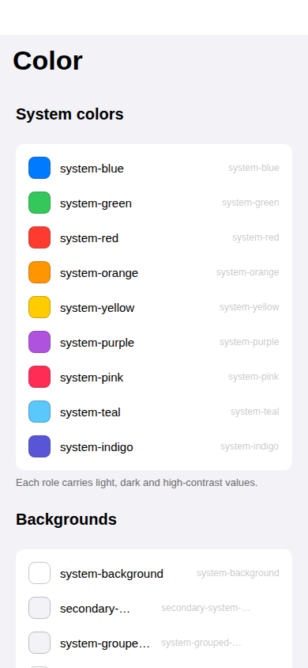
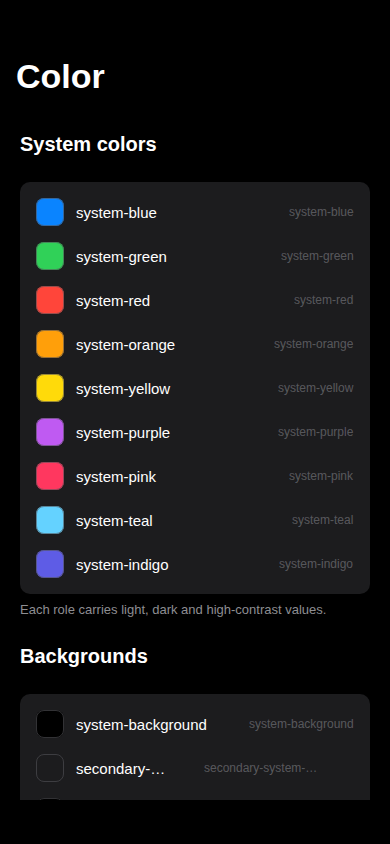
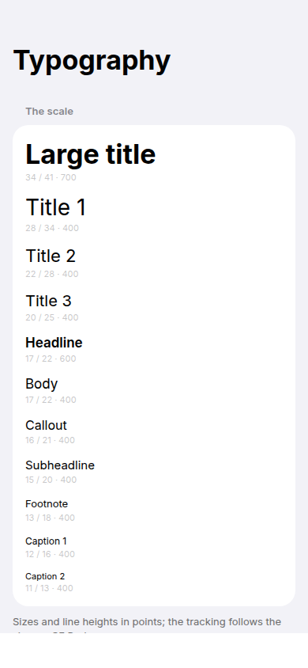

[English](theme.md)

# 主题与 token

`Theme` 为应用安装 Cupertino 的 token，并在应用要求时切换到高对比度取值。`tokens` 是它背后的数据。

| | |
| --- | --- |
| 浅色 |  |
| 深色 |  |
| 字号 |  |

| TSX | Rust | 类型 | 默认值 | |
| --- | --- | --- | --- | --- |
| `contrast` | `.contrast(..)` | `"normal"` \| `"high"` | `normal` | 对比度取值 |
| `children` | `.child(..)` | JSX | — | 应用 |

## Token

| 分组 | 名称 |
| --- | --- |
| 背景 | `system-background`、`secondary-system-background`、`tertiary-system-background` |
| 分组 | `system-grouped-background`、`secondary-system-grouped-background`、`tertiary-system-grouped-background` |
| 文字 | `label`、`secondary-label`、`tertiary-label`、`quaternary-label`、`placeholder-text` |
| 分隔 | `separator`、`opaque-separator` |
| 填充 | `fill`、`secondary-fill`、`tertiary-fill`、`quaternary-fill` |
| 灰阶 | `system-gray`、`system-gray2` … `system-gray6` |
| `cupertino_ui` 自有 | `section-header-footer`、`clear-button`、`text-field-disabled-background`、`activity-tick` |
| 系统色 | `system-blue`、`system-green`、`system-red`、`system-orange`、`system-yellow`、`system-purple`、`system-pink`、`system-teal`、`system-indigo`、`system-gray`、`link` |
| shadcn 别名 | `background`、`foreground`、`card`、`popover`、`primary`、`secondary`、`muted`、`accent`、`destructive`、`border`、`input`、`ring`、`selection` |

TSX 里 token 就是类名：`bg-system-blue`、`text-secondary-label`、`border-separator`。
Rust 里是函数：`tokens::system_blue()`、`tokens::secondary_label()`；两者都是响应式的。

## 预设

默认是系统色。`Theme` 的 `preset` 属性会用一套配色覆盖它命名的角色：`preset="cohub"` 是
Cohub Mobile 的配色（`src/design/tokens.ts`）：暖纸色 `#f6f3ee` 与 `#121214`、着色
`#bf3f00` 与 `#ff8a3d`、白色或 `#1c1c1e` 的表面、暖灰与状态色。高对比度仍使用系统色，与其他角色一致。
生成的主题文件（`theme/theme.json`）仍是系统色，所以 `bg-system-blue` 等类名暂不跟随预设；Rust 组件跟随。

## 材质

`tokens::materials` 保存浮动层的玻璃：`ultra-thin`、`thin`、`regular`、`thick` 与 `chrome`，
每种是按外观的填充（高对比度下更不透明）加 20–30 pt 的模糊半径。TSX 里是类名
（`bg-material-regular`、`backdrop-blur-xl`）；Rust 里是 `tokens::materials::fill` 与
`tokens::materials::blur`，`NavigationBar` 与 `NavPage` 的 `material` 就是这么用的。

玻璃只属于浮动层——栏、Sheet、浮在内容上的控件——永远不属于内容本身；见
`docs/design-notes.md` 对 `materials.md` 与 `liquid-glass.md` 的引用。

## 高对比度怎么工作

主题文件格式（`nsh.json` 的 `"theme"`，即 shadcn 的 `cssVars`）只有浅色与深色两个值，所以
高对比度取值放在 `src/tokens.rs`。`Theme` 会：

1. 读取应用的 token；
2. 补齐应用没设置的 Cupertino token；
3. `contrast="high"` 时，把每个角色与别名设为当前外观下的高对比度取值；
4. 用 `set_tokens` 安装结果。

因为每个组件都通过绑定读取颜色，切换时只重绘、不重挂载；切回时恢复应用自己的 token。外观
（`dark()`、`colorScheme()`）也会被读取，所以在高对比度开启时系统切换外观，会取那个外观的
高对比度取值。

NSH 目前没有对比度信号：由应用决定（Web 上读平台的 `prefers-contrast`，或自己的设置），再传给这里。

## 字号表

| 级别 | 字号 / 行高 | 字重 |
| --- | --- | --- |
| largeTitle | 34 / 41 | 700 |
| title1 | 28 / 34 | 400 |
| title2 | 22 / 28 | 400 |
| title3 | 20 / 25 | 400 |
| headline | 17 / 22 | 600 |
| body | 17 / 22 | 400 |
| callout | 16 / 21 | 400 |
| subheadline | 15 / 20 | 400 |
| footnote | 13 / 18 | 400 |
| caption1 | 12 / 16 | 400 |
| caption2 | 11 / 13 | 400 |

Rust：`TypeScale::from_theme()` 返回十一个 `TextStyle`（`size`、`line_height`、`weight`、
`tracking`），每个都从主题读取，应用可以改任一项。字距跟随 SF Pro：34 pt 时 +0.38，17 pt 时 −0.41。

## 无障碍

- 颜色在浅色与深色下都达到对比度要求；高对比度取值使用 iOS 自己的值（文字 68–96 % 不透明度，
  分隔更深，系统色被推离背景）。
- 文字遵循用户字号设置；组件以点数确定盒子尺寸，让文字可以变大。
