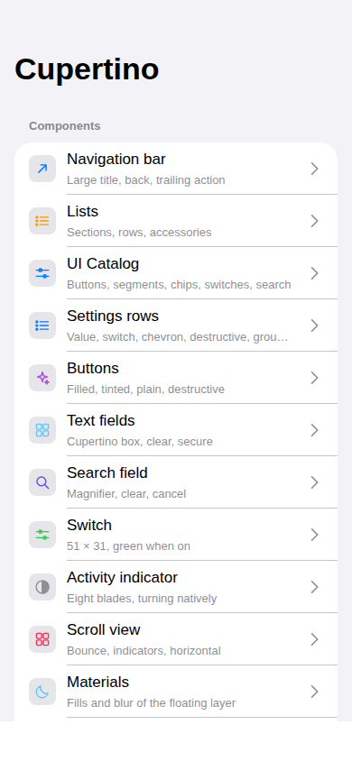
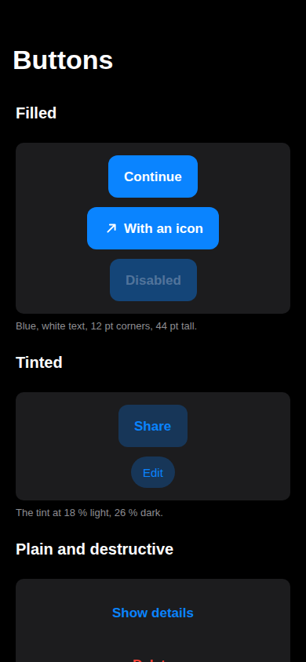

# nsh-cupertino 0.1.0

[简体中文](v0.1.0.zh-CN.md)

The first release: a Cupertino (iOS) design system for Native Shell apps — Apple's
semantic colors, type scale and metrics as tokens, and the components iOS draws
settings and detail screens with.

## Install

```toml
[dependencies]
nsh-cupertino = { git = "https://github.com/markbang/nsh-cupertino", tag = "v0.1.0" }
```

```json
{
  "rust": ["../nsh-cupertino", "."],
  "theme": "../nsh-cupertino/theme/theme.json"
}
```

## What is in it

**Tokens** — 28 semantic color roles (`system-background`,
`secondary-system-grouped-background`, `label`, `secondary-label`, `separator`,
`fill`, `system-blue` … `system-indigo`), each with light, dark and both
increased-contrast values, the eleven-step type scale with iOS's tracking, the
4/8/12/16/20/24 spacing and 44 pt touch target, 10/14/12/9 pt radii, the 0.33 pt
hairline and the motion springs. `theme/theme.json` is generated from the same
table, so `bg-system-blue` in TSX, `tokens::system_blue()` in Rust and `token()`
read one set of values.

**Theme** — installs the tokens, keeps what the app sets, and swaps in the
high-contrast values of the current appearance when the app asks for them.

**Components** — `NavPage` and `NavigationBar` (large title collapsing into the
bar natively from the scroll offset), `List`, `Section` and `ListTile` (inset
grouped, 10 pt corners, hairline separators inset to the text, chevron and
checkmark accessories), `Button` (filled, tinted, plain, destructive × three
sizes), `TextField` and `SearchField` (clear, reveal, keyboards, return keys),
`Switch` (51 × 31, 27 pt thumb, 200 ms), `ActivityIndicator` (eight blades,
native keyframes, still frame under reduced motion), `ScrollView` (bounce,
indicator, drag-to-dismiss keyboard), and 24 icons drawn as SVG in `currentColor`.

**Demo and tests** — one page per component plus a gallery index, in TSX over the
crate with the gallery rows and the press counter in the app's own Rust half; nine
headless tests; every page captured in light and dark from the web build.





## Accessibility

Rows are named buttons with their state, headings are headers, sections groups,
lists lists, the spinner a progress indicator; icon-only controls always have a
name; Tab reaches every control with a visible ring, Space and Return press,
Escape and the Android back gesture go back (all from `nsh/base`); the spinner
honours reduced motion.

## Known gaps (wave B)

Action sheets, alerts, context menus, sheets with detents, pickers and date
pickers, segmented control, slider, tab bar, swipe actions and pull to refresh
are not in this release. There is no blurred navigation bar, and the components
are verified on the web build and headless, not yet on iOS, Android or a desktop.

## License

MIT OR Apache-2.0.
