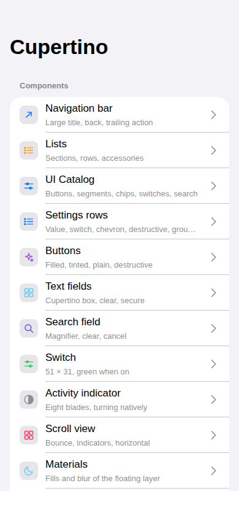
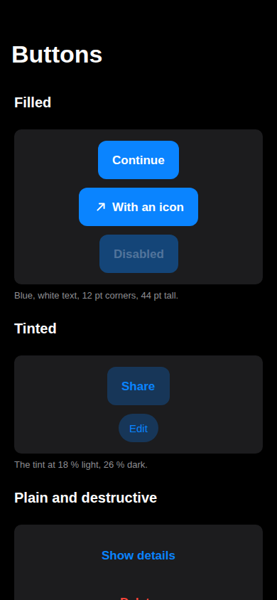

# nsh-cupertino 0.1.0

[English](v0.1.0.md)

第一个版本：面向 Native Shell 应用的 Cupertino（iOS）设计系统——把 Apple 的语义色、字号表与
度量做成 token，并提供 iOS 设置页、详情页使用的组件。

## 安装

```toml
[dependencies]
nsh-cupertino = { git = "https://github.com/markbang/nsh-cupertino", tag = "v0.1.0" }
```

```json
{
  "rust": ["../nsh-cupertino", "."],
  "theme": "../nsh-cupertino/theme/theme.json"
}
```

## 包含什么

**Token** —— 28 个语义色角色（`system-background`、`secondary-system-grouped-background`、
`label`、`secondary-label`、`separator`、`fill`、`system-blue` … `system-indigo`），每个都有
浅色、深色与两个高对比度取值；十一级字号表与 iOS 字距；4/8/12/16/20/24 间距与 44 pt 触控目标；
10/14/12/9 pt 圆角；0.33 pt 细线；动效弹簧。`theme/theme.json` 由同一张表生成，所以 TSX 的
`bg-system-blue`、Rust 的 `tokens::system_blue()` 与 `token()` 读到同一组值。

**Theme** —— 安装 token，保留应用自己的设置，并在应用要求时切换到当前外观的高对比度取值。

**组件** —— `NavPage` 与 `NavigationBar`（大标题随滚动在原生侧收缩进栏里）、`List`/`Section`/
`ListTile`（分组内嵌、10 pt 圆角、细线内缩到文字、右箭头与勾选）、`Button`（实心、浅色、纯文字、
危险 × 三档尺寸）、`TextField` 与 `SearchField`（清除、显示、键盘、回车键）、`Switch`
（51 × 31、27 pt 滑块、200 ms）、`ActivityIndicator`（八片叶片、原生关键帧、减少动态效果时静止）、
`ScrollView`（回弹、滚动条、拖动收起键盘），以及 21 个用 `currentColor` 绘制的 SVG 图标。

**演示与测试** —— 每个组件一页，加一个画廊首页；TSX 写在 crate 之上，画廊的行与按压计数在应用
自己的 Rust 部分；9 个无头测试；每个页面都有浅色与深色截图。





## 无障碍

行是带状态的具名按钮，标题是 header，分区是 group，列表是 list，加载指示器是 progress
indicator；纯图标控件总有名称；Tab 能到达每个控件并显示焦点环，空格与回车按下，Escape 与
Android 返回手势回退（均来自 `nsh/base`）；加载指示器尊重"减少动态效果"。

## 已知缺口（wave B）

操作表、警告框、上下文菜单、带档位的 Sheet、选择器与日期选择器、分段控件、滑块、标签栏、
滑动操作与下拉刷新不在本版本中。没有模糊导航栏；组件只在 Web 构建与无头环境下验证，尚未在
iOS、Android 或桌面上验证。

## 许可

MIT OR Apache-2.0。
