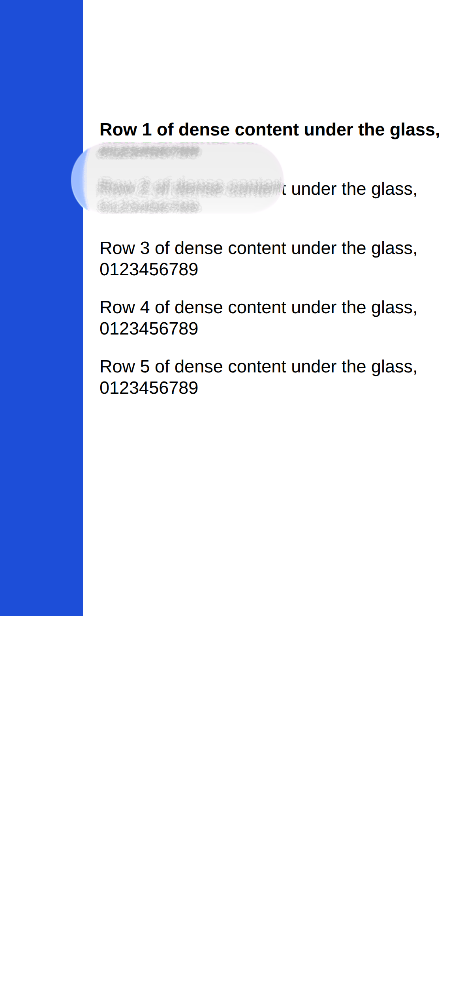

# nsh-cupertino 0.3.0

[简体中文](v0.3.0.zh-CN.md)

Liquid Glass, for real: the material Apple shipped with iOS 26, drawn by a GPU
shader on every bar, sheet, alert, menu and floating control of the library —
and, where there is no GPU, the material's own fill and blur, unchanged.

## What changed

- **`Glass`, `GlassButton`, `GlassGroup`** — the material of the floating layer.
  A surface reads what is behind it, bends that picture through the height field
  of its rounded rect (the rim refracts and magnifies what lies just outside it,
  the middle stays flat), blurs it, tints it by variant, and adds a specular rim
  whose lit side follows the light. Text drawn over it stays crisp: the platform
  draws the content, the shader draws the material under it.
- **Variants** — `regular` for bars, `clear` for media, `thick` under text,
  `interactive` for a control (a press springs the lens, widens the specular and
  squashes the shape by 3,5 %, or at once with Reduce Motion), `tinted` for one
  action. The tint thickens on its own where the backdrop would fight the label.
- **Shapes** — rounded rect with any corner radius, capsule, circle; `quality`
  from 17 blur samples down to 1; an app-driven light angle.
- **`GlassGroup`** — two shapes in one material, fused with a smooth neck inside
  `spacing`: the crate's reading of Apple's `GlassEffectContainer`.
- **Every floating surface** — the navigation bar (content scrolls under it, the
  lens follows the rows), the tab bar, sheets, action sheets, alerts, the search
  field's box (`SearchField`'s `glass`) and `GlassButton` for floating controls.
- **`tokens::glass`** — the material's numbers and three fills, which follow
  `Theme`'s increased contrast (near opaque, as the HIG asks).

## Where it is an approximation

Apple publishes no implementation, so the shading is this crate's. What is real:
the backdrop is sampled and *displaced* (the rim genuinely refracts), the blur is
a blur of that picture, and the specular is directional. What is chosen: the
height profile, the strengths, the exact highlight shape, and the adaptive tint.
`GlassGroup` merges two shapes but does not morph their content; the light angle
is the app's, because NSH reports no device motion. `docs/design-notes.md` has
the table, part by part.

## Evidence

- Comparison on the same backdrop — no glass, the material without a GPU, the
  shader: 
- Two pixel checks, run by `tools/glass-pixels.mjs` on the screenshots above:
  the rim is brighter than the flat middle (the specular), and a hard edge 10 pt
  inside the rim moves 3,7 pt (the lens) while the blur-only material leaves it
  where it is.
- Light and dark, increased contrast, and the demo pages: `glass-light`,
  `glass-dark`, `glass-light-contrast`, `glass-dark-contrast`.

## Platform notes

| | |
| --- | --- |
| iOS, macOS, Windows, Linux, Android | wgpu: the shader draws the material, the platform draws the content over it. |
| Web | WebGL 2. **Needs `tools/patch-runtime.mjs` on the build**: NSH 0.5.x binds only the fragment stage's uniform block, so WebGL rejects every shader draw until NSH fixes it (the upstream fix is one line in `nsh.js`; `docs/design-notes.md` says where). |
| No GPU | The material's fill and backdrop blur from `tokens::materials`: the same look the bars had in 0.2.x. |
| Reduce Motion | The press keeps its values and drops its springs. |
| Increased contrast | Near-opaque glass, from `tokens::glass`. |

## Upgrading

Nothing to do: the components keep their props, and a `material` name
(`"regular"`, `"thin"`, `"thick"`, …) still picks the look — it now draws glass
where a GPU shader is available. `SearchField` and `GlassButton` are opt-in.
