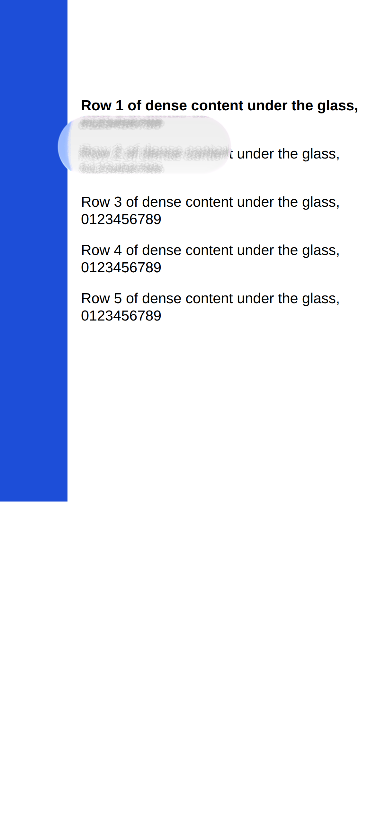

# nsh-cupertino 0.3.0

[English](v0.3.0.md)

真正的液态玻璃：Apple 随 iOS 26 推出的材质，由 GPU shader 绘制在本库的每个栏、sheet、
弹窗、菜单和浮动控件上——而在没有 GPU 时，退回材质自身的填充与模糊，观感不变。

## 变更

- **`Glass`、`GlassButton`、`GlassGroup`** —— 浮动层材质。表面读取身后画面，用自身圆角矩形
  的高度场弯折它（边缘折射并放大紧贴形状外侧的内容，中间保持平整），再模糊、按变体着色，
  并加上一条受光照方向影响的高光环。绘制在其上的文字依然锐利：平台绘制内容，shader 在下方绘制材质。
- **变体** —— `regular` 用于栏，`clear` 用于媒体，`thick` 用于文字，`interactive` 用于控件
  （按压缩放镜头、扩散高光、压缩 3.5 %；降低动态效果时直接到位），`tinted` 用于单一操作。
  当背景会与文字冲突时，着色会自行加厚。
- **形状** —— 任意圆角矩形、胶囊、圆形；`quality` 从 17 次模糊采样降到 1 次；光照角度由应用给出。
- **`GlassGroup`** —— 两个形状共享一个材质，在 `spacing` 内以平滑颈部融合：本库对 Apple
  `GlassEffectContainer` 的理解。
- **所有浮动表面** —— 导航栏（内容从其下滚过，镜头跟随列表）、标签栏、sheet、操作表、弹窗、
  搜索框（`SearchField` 的 `glass`）以及浮动控件 `GlassButton`。
- **`tokens::glass`** —— 材质的数值与三种填充，跟随 `Theme` 的增强对比度（接近不透明，符合 HIG）。

## 近似之处

Apple 未公开实现，因此着色由本库完成。真实的部分：背景被采样并被**位移**（边缘确实发生折射），
模糊是那幅画面的模糊，高光有方向。选定的部分：高度曲线、强度、高光的确切形状，以及自适应着色。
`GlassGroup` 会融合两个形状，但不会迁移它们的内容；光照角度由应用给出，因为 NSH 不报告设备姿态。
`docs/design-notes.md`（英文）有逐项对照表。

## 证据

- 同一背景下的对照——无玻璃、无 GPU 时的材质、shader：
- 两项像素断言，由 `tools/glass-pixels.mjs` 在上述截图上运行：边缘比平坦中部更亮（高光），
  以及距边缘 10 pt 的硬边移动了 3.7 pt（镜头），而只有模糊的材质不会移动它。
- 浅色、深色、增强对比度与演示页：`glass-light`、`glass-dark`、`glass-light-contrast`、
  `glass-dark-contrast`。

## 平台说明

| | |
| --- | --- |
| iOS、macOS、Windows、Linux、Android | wgpu：shader 绘制材质，平台在其上绘制内容。 |
| Web | WebGL 2。**构建产物需要 `tools/patch-runtime.mjs`**：NSH 0.5.x 只绑定 fragment 阶段的 uniform block，在 NSH 修复前 WebGL 会拒绝所有 shader 绘制（上游修复是 `nsh.js` 里的一行；`docs/design-notes.md` 说明了位置）。 |
| 无 GPU | 退回 `tokens::materials` 的填充与背景模糊：与 0.2.x 的栏观感一致。 |
| 降低动态效果 | 按压保留数值，去掉弹簧。 |
| 增强对比度 | 接近不透明的玻璃，来自 `tokens::glass`。 |

## 升级

无需改动：组件属性不变，`material` 名称（`"regular"`、`"thin"`、`"thick"` 等）仍决定观感——
现在在有 GPU shader 时绘制玻璃。`SearchField` 与 `GlassButton` 是可选新增。
