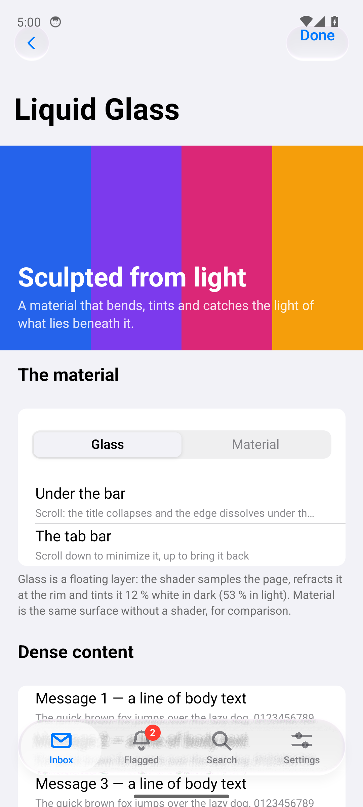
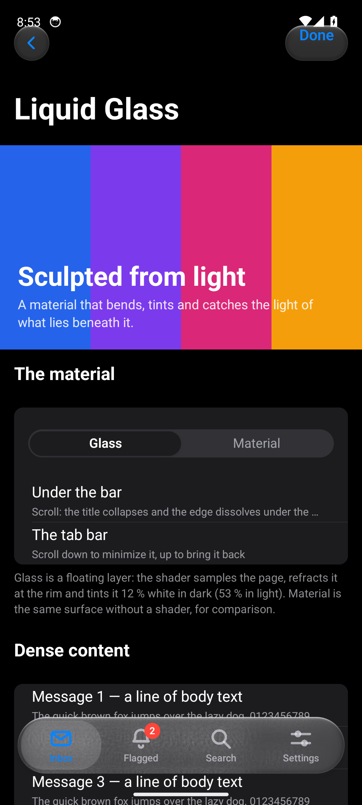
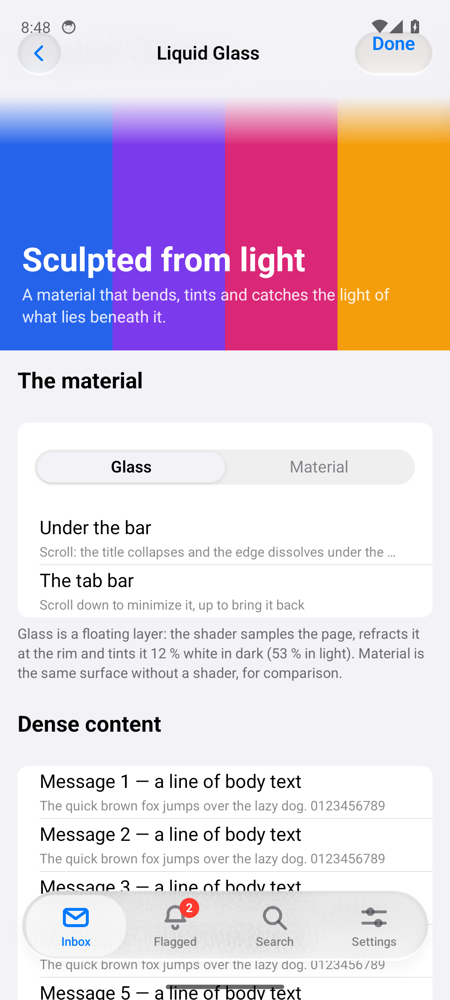
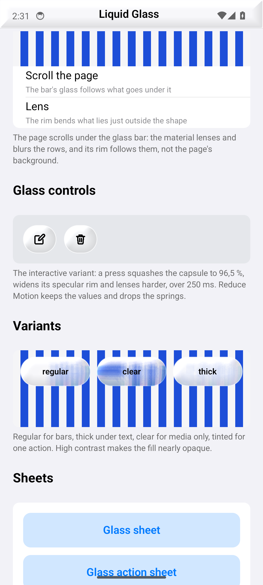
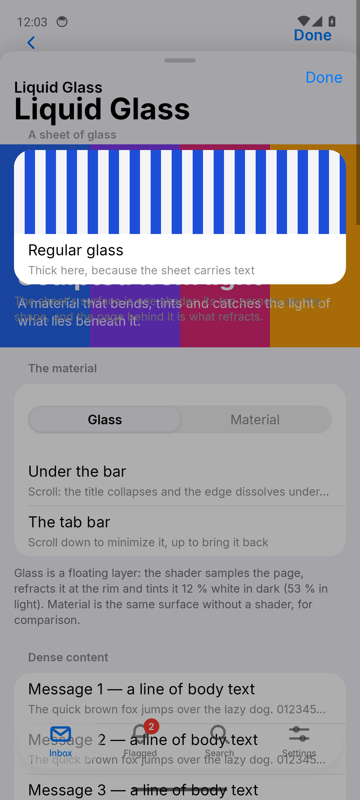

# nsh-cupertino 0.3.3

[简体中文](v0.3.3.zh-CN.md)

The Liquid Glass material, drawn on Android: 0.3.0 shipped the shader with the
honest note that no Android frame had ever been rendered where it was written.
This release adds the run that draws them, and the frames it keeps.

## What changed

- **An Android emulator run** — `.github/workflows/android-ui.yml` packages the
  demo for `x86_64`, boots an API 34 device (SwiftShader: a CI runner has no
  GPU), installs it and drives it with `adb`: light and dark, the page scrolled so
  its striped band is under the bar, the capsule variants, the glass sheet, and
  the calibration page three ways. It also packages `arm64-v8a`, the artifact a real device installs.
- **A guard against the silent failure** — `tools/android-glass-check.mjs` fails
  the run when a capture is blank (black, or one colour: what a shader that does
  not compile produces), when a step changed nothing, and when the material
  draws without its lens: the edge 10 pt inside the capsule's rim has to move.
- **One screenshots branch for both platforms** — `tools/publish-shots.sh` adds
  a run's files to the branch instead of resetting the other run's.

Nothing in the crate changed: the same components, the same tokens, the same
values.

## Evidence

| | |
| --- | --- |
| Light, over content that scrolls under it |  |
| Dark |  |
| Scrolled, the striped band under the bar |  |
| The capsule variants over stripes |  |
| The glass sheet |  |

Captured on a 1080×2400 `pixel_6` profile, `screencap` straight from the device:
status bar and all. The run measures the material the way the web pixel test
does, on the calibration pages, where a capsule sits over a hard edge 10 pt
inside its rim — a blur leaves that edge where it is, a lens changes it:

- the blue field behind the capsule, in a row through its middle, ends at
  **184 px** on the page, **157 px** through the material's fill and **417 px**
  through the shader (light; 386 px in dark): the rim magnifies what lies behind
  it, which a fill cannot do;
- dark is dark: the top of the page goes from **0.86** mean luminance in light
  to **0.23** in dark, and the scroll, the capsules and the sheet each change the
  frame.

## Platform notes

| | |
| --- | --- |
| Android | wgpu over SwiftShader's OpenGL in CI (API 34), Vulkan or OpenGL on a phone: the shader draws the material, the platform draws the content over it. Verified by `android-ui.yml`. |
| iOS, macOS, Windows, Linux | wgpu (Metal, Vulkan, Direct3D 12, OpenGL), unchanged: no emulator or runner draws them yet. |
| Web | WebGL 2, still with the uniform-block fix in `tools/patch-runtime.mjs` until NSH binds both stages' blocks. |

## Upgrading

Nothing to do: no API, no token and no behaviour changed.
